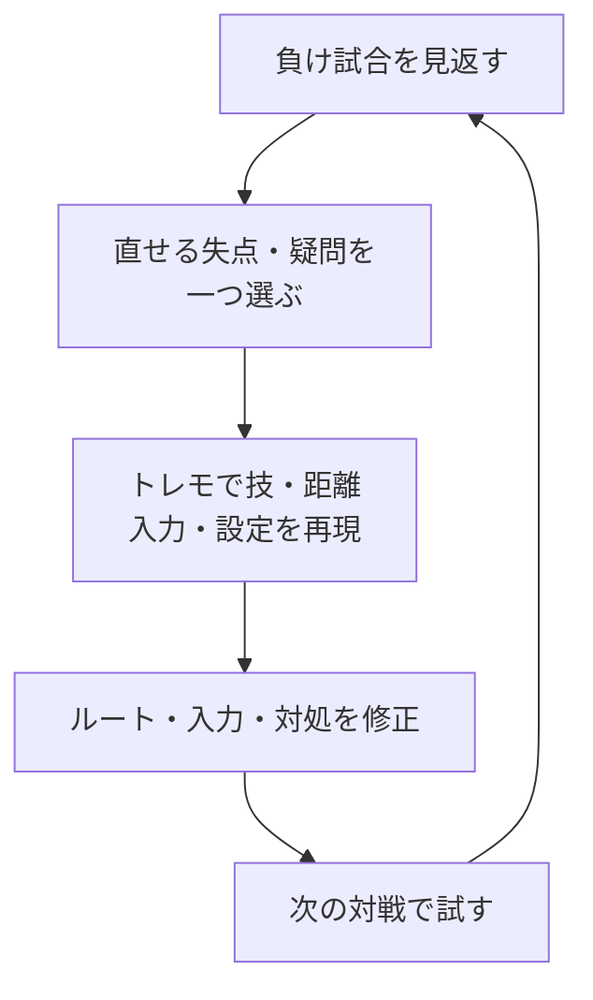

# SF6共通基礎：勝ち筋・読み合い・練習

[キャラ一覧](../README.md) · [記法](notation.md) · [イングリッド](ingrid/README.md)

**触る方法、触った後の択、失敗した後の立て直しを一組で用意する。**
[あくあ総研](https://acqua-souken.com/)の講座から、キャラをまたいで使う考え方を整理する。

参照したのは、サイトの自動字幕・文字起こしをもとにした動画ノート。
各節に出典リンクと動画公開日を添える。イングリッドへの適用例は本ノートでの整理で、
講座内の他キャラの技・数値・コンボをそのまま移したものではない。確認日：2026-11-04。

[勝ち筋](#gameplan) / [差し返し](#neutral) / [D運用](#drive)
/ [攻め](#offense) / [守り](#defense) / [セットプレイ](#setplay)
/ [練習・リプレイ](#practice) / [イングリッドへの適用](#ingrid)

## 勝ち筋：入口と、その後に得るものを決める

**最初は、主力の触り方を1〜2個と、ダウン後の続きまで決める。**
単発の技を当てることだけで終わらず、端へ運ぶ、投げの択をかける、
投げ抜けを狩る、残体力を取り切る、という次の目的を持つ。

- **入口**：どの距離・技から接触するか。ヒットなら何につなぎ、ガードなら何を選ぶか。
- **ダウン後**：再接近・弾・回収のどれに進むか。中央の投げ後も決めておく。
- **攻めない間**：対空や接近の迎撃を待つ。自分から動く時間と役割を変える。

リーサルは、実際に当てる始動・使えるゲージ・対応コンボで判断する。
講座の体力目安を、全キャラ・全始動の保証ダメージとして使わない。

参照：[戦い方のスタートとゴール](https://acqua-souken.com/v/tZPFHI21L04/)
（2026-10-07）。
[原動画](https://www.youtube.com/watch?v=tZPFHI21L04)

## 差し返し：対象の技と、返す技を絞る

**何でも空振りを見てから返そうとせず、狙う相手の技・距離・入力タイミングを先に決める。**
講座では、ガードを保ちながら相手の技に合わせて入力し、
届いた場合はガード、届かなかった場合は自分の技が出る形を練習する。

練習対象は相手の中足・中P・大Pなど数個から始め、返す技も少なくする。
自キャラで届き、間に合い、当てた後の展開を取れる技を選ぶ。
入力が遅れてガード後に技が出る場合も含め、録画した同じ技でタイミングを確かめる。

「差し返し用の技を決めること」と「その練習を最優先にすること」は別。
コンボ・起き攻め・対空などの取りこぼしが多ければ、そちらも直す。

参照：[差し返しのコツ](https://acqua-souken.com/v/ELqbxdcNeeE/)
（2026-04-04）。
[原動画](https://www.youtube.com/watch?v=ELqbxdcNeeE)

## D運用：接触への投資と、回復する時間を組にする

**待つ相手を崩す入口として、届く技からのキャンセルDRを比較する。**
ジャンプ・生DR・弾を何度も見てから返されているなら、同じ接近だけを繰り返さない。
接触後に投げやシミーへ進み、攻めが途切れたら対空・迎撃を意識しながらDを戻す時間を作る。

回復したい時間に弾をガードし続ければ、Dは削られる。
弾を避ける・自分の弾で制限するなど、相手との距離に合う行動を選ぶ。
再接触をいつ選ぶかは、自分のDだけでなく画面位置・体力・残り時間も含めて考える。

参照：[ガン待ち相手へのアドバイス](https://acqua-souken.com/v/XutOEerp6Uw/)
（2026-01-22）。
[原動画](https://www.youtube.com/watch?v=XutOEerp6Uw)

## 攻め：打撃・投げ・シミーを相手の防御に合わせて混ぜる

**有利Fと距離が整った場面で、先に選ぶ択の相性を考える。**
相手の防御をすべて見てから返すという意味ではない。

| 自分の択 | 狙う相手の行動 | 外れたときに見ること |
| --- | --- | --- |
| 打撃 | 暴れ、ジャンプなど | ガード・パリィ、無敵技、打撃の隙間 |
| 投げ | ガード・パリィ | 投げ抜け、投げを避ける行動、投げ間合い |
| 後ろ歩きシミー | 投げ抜け | 下段・前進打撃、相手が投げを押さない場合 |

投げを嫌がって投げ抜けを使う相手には、シミーの機会が生まれる。
投げを押さない相手へシミーを繰り返しても、直接のダメージは増えない。
打撃・投げが重なるか、後ろ歩きで投げを外せるかは、その場面で確かめる。

参照：[起き攻めの3択と守り方](https://acqua-souken.com/v/xhg2IXDGTpk/)
（2025-09-01）。
投げとシミーの関係は[入口とゴールの講座](https://acqua-souken.com/v/tZPFHI21L04/)
（2026-10-07）も参照。

## 守り：同じ防御だけで、同じ択に負け続けない

**ガードを土台にし、何を避けるために別の防御を使うかを決める。**
打撃重ねに小技連打で勝てた場面は、相手の重ねが遅れていただけの場合がある。

| 自分の防御 | 狙い | 注意する相手の択 |
| --- | --- | --- |
| ガード | 打撃を受け止め、投げ空振り狙いにも付き合わない | 投げ、ガードによるD削り |
| 遅らせ投げ抜け | 先に打撃をガードし、投げなら抜ける | シミー、タイミングをずらす打撃 |
| 無敵技 | その技で対応できる打撃・投げを切り返す | 様子見・ガード、相手の間合い外 |
| 一瞬ガード後の下段 | 打撃重ねを受けてから、後ろ歩きを咎める | 遅らせ打撃、下段が届かない距離 |

遅らせ投げ抜けと無敵技だけでは、どちらも様子見・シミーに大きく負け得る。
遅らせ投げ抜けを練習しつつ、相手がシミーを使うならガードなども混ぜる。
防御の習得順は、2025年の講座で以前の投げ抜けへの助言を見直しているため、公開時期も読む。

小技を数回ガードした後に打ち返すのは、距離が離れる場面を探す目安。
必殺技キャンセル・有利技・連係の隙間を確認して、相手の技ごとに答えを作る。

参照：[守り方の極意](https://acqua-souken.com/v/xhg2IXDGTpk/)
（2025-09-01）。
[原動画](https://www.youtube.com/watch?v=xhg2IXDGTpk)

## セットプレイ：締めから重ねまでを再現する

**ダウン後の重ねを、毎回の目分量だけに任せない。**
締め、移動や空振りによる時間調整、その後の打撃・投げまでを一組にする。
持続を当てれば有利Fやつながるコンボが変わる場合もある。

覚えるときは、成功時の入力だけでなく、開始位置・締めの高度・実際の有利Fもそろえる。
まず1つを安定させ、打撃・投げ・シミーへ分岐するところまで練習する。

参照：[セットプレイの重要さ](https://acqua-souken.com/v/UOyRRdreUyE/)
（2026-10-10）。
[原動画](https://www.youtube.com/watch?v=UOyRRdreUyE)

## 練習・リプレイ：直せる失点を一つずつ戻す

**完走できるコンボと、その後の行動を先に安定させる。**
試合で使うルートは成功率も含めて選び、難しい火力型は練習してから使う。

参照：[脱初心者のための練習課題](https://acqua-souken.com/v/Qi4kyyYcpgI/)
（2026-01-07）。

### トレモでは調べるものに合わせて相手を設定する

入力履歴・攻撃情報・フレームメーターを表示し、同じ位置からやり直せる状態を作る。

| 調べるもの | 設定・再現すること | 見る結果 |
| --- | --- | --- |
| コンボ | 通常 / CH / PCを分け、相手はガードなし | 指定条件で最後までつながるか |
| ヒット確認 | ヒット・ガードを混ぜる | ヒット時につなぎ、ガード時に止められるか |
| 確定反撃 | 相手の技→ガードを録画する | 届いて間に合うか。距離が変わっても同じか |
| 起き攻め・シミー | 打撃・投げ・何もしない等を別々に記録する | 固定再生でタイミングを確認し、混ぜても選べるか |

参照：[トレモの使い方](https://acqua-souken.com/v/B05MttJA9lc/)
（2025-07-08）。

### リプレイの疑問を、次の対戦まで持ち越さない

負けを読み合いの感想だけで終わらせず、コンボミス・対空漏れ・重ねの失敗・
知らなかった反撃といった、調べて直せる場面を探す。被弾した直前に何をしていたかも見る。

以下は、講座の復習方法をこのノートで繰り返せる手順にしたもの。

メモは「相手の行動 → 自分がしたこと → 起きた結果 → 次に試すこと」で残す。
有利Fや距離が分からなかった場面を再現し、判明したことをキャラ別の該当ページへ戻す。

参照：[リプレイから強くなる考え方](https://acqua-souken.com/v/SRkzhMn0JoA/)
（2023-09-22）。
[原動画](https://www.youtube.com/watch?v=SRkzhMn0JoA)

## イングリッドへ当てはめる

**以下は、本ノートの既存ルート・条件に沿った適用例。**
一般講座の「無敵技」「端の柔道」「最大コンボ」を使えるかは、イングリッドの性能で判断する。

| 共通の考え方 | このノートで具体化する場所 |
| --- | --- |
| 接触の入口と、待つときの役割を決める | [地上戦の狙い](ingrid/neutral.md#gameplan) / [戦略の比較](ingrid/strategy.md#comparison) |
| 待つ相手に接触し、Dを使った後に立て直す | [キャンセルDRで触る](ingrid/neutral.md#versus-wait) |
| 打撃・投げ・シミーを混ぜる | [+2Fの読み合い](ingrid/pressure.md#dr5hk-guard) / [シミーの手順](ingrid/punish.md#shimmy) |
| 投げ後に同じ攻めへ戻れるか調べる | [前投げ→66](ingrid/okizeme.md#throw-dash)。投げが4F暴れに一方的に勝つループではない |
| 使える防御を自キャラの性能で選ぶ | [サンライズ](ingrid/moves.md#sunrise)。OD版にも無敵はない |
| セットプレイとヒット確認を練習する | [締め別起き攻め](ingrid/okizeme.md#after-ender) / [小技の分岐](ingrid/pressure.md#dr5hk-guard) |
| 被弾・取り逃しから課題を作る | [反撃の練習](ingrid/punish.md#practice) / [自由メモ](ingrid/memo.md) |

## あくあ総研から続きを探す

- [教科書](https://acqua-souken.com/book/)から、立ち回り・攻め・守り・練習をテーマ別に探す。
- [動画ノート](https://acqua-souken.com/videos/)から、説明のまとまりと公開日を確認する。
- [キャラ別](https://acqua-souken.com/chars/)の使い方と対策は、どちら側の視点かを確認する。
- [用語集](https://acqua-souken.com/glossary/)で、講座中の用語と元の説明へ戻る。
