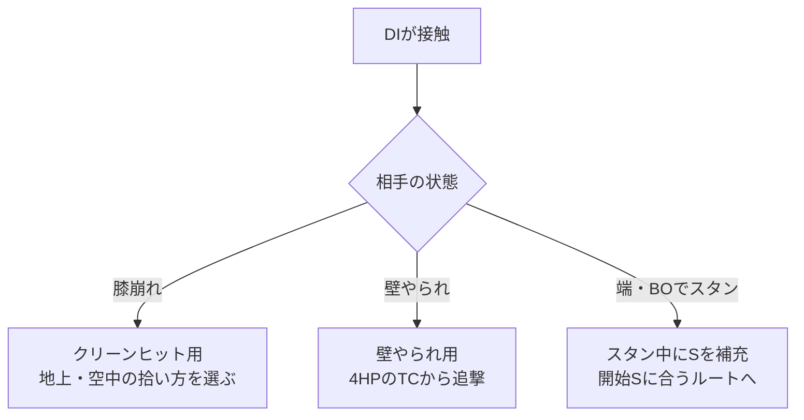

# イングリッド：DI・壁やられ・BOスタン

[イングリッド](../README.md) › [コンボ](../combos.md) › DIの結果から選ぶ

[端の攻め](../pressure.md#corner-pressure) · [締め後](../okizeme.md#after-ender)
· [SA締め](finishers.md) · [記法](../../notation.md)

**DIの結果を確認し、膝崩れ・壁やられ・BOスタンのレシピを分ける。**
同じ追撃でも始動・補正・拾う高さが異なるため、ダメージを共用しない。
以下のDは始動のDIの1Dを含む。掲載値は公開資料の参考値で、現行版の再実測値ではない。



[膝崩れ](#clean-hit) / [壁やられ](#wall) / [BOスタン](#stun)

<a id="clean-hit"></a>

## クリーンヒット：膝崩れ中の拾い方

| 完全入力 | 掲載ダメージ | 消費・回収 | 条件 |
| --- | ---: | --- | --- |
| `DI[PC] > 66 > 4HP~HP:214MP` | 2,700 | D1、S消費0 | 中央の前ステからTCで拾う例 |
| `DI[PC] > 236HK > j.214MP` | 2,540 | D1、S消費0 | 強ライズから中空フレアで締める |

DI後は早く拾うと地上食らい、遅く拾うと空中食らいになるという報告例。
地上用TCと、打ち上げ後の追撃を、同じタイミングで始めない。

画面端でクリーンヒットした場合の別候補：

```text
DI[PC・画面端] > 4HP~HP:214MP > 236MK
```

D1、S消費0。参考ダメージ3,180。
次の壁やられ型と追撃の技列が同じでも、3,180を壁やられのダメージには使わない。

<a id="wall"></a>

## 壁やられ：4HPのTCからつなぐ

| 完全入力 | 掲載ダメージ | 消費・回収 | 条件 |
| --- | ---: | --- | --- |
| `DI[壁やられ] > 4HP~HP:214MP > 236MK` | 2,432 | D1、S消費0 | ノーSの基本型 |
| `DI[壁やられ] > 4HP~HP:236HP > 236HP` | 2,064 | D1、S消費0 | +42F・詐欺飛び候補の報告例 |

+42Fや詐欺飛びの成立は、接触高さ・入力と相手の無敵技で確かめる。

開始2S以上でODフレアに使う型：

```text
DI[壁やられ] > 4HP~HP:OD.214P[S消費2] > 2KKK > 236MK
```

D3、S2消費。参考ダメージ3,344。開始1SのOD版とは消費S・吹き飛びが異なる。
中ライズ締め後は[実ルートのダウンF](../okizeme.md#after-ender)を確認する。

<a id="stun"></a>

## BOスタン：回収してから使うSを決める

**ここからは、端・BO相手へDIをガードさせてスタンした場合。**
スタンしたかを確認してから回収に入る。通常の壁やられ中に同じ回収を挟まない。

### まずスタン前のSを見る

| スタン前のS | 回収動作2回後のS | 後続ルートで見ること |
| --- | ---: | --- |
| 0S | 2S | 2Sを残すか、最初のOD空フレアへ使うか |
| 1S | 3S | 2S消費後に残る1Sを、後半ODフレアへ使える |
| 2S | 4S | 2S消費後も2S残る。1S用の後半へそのまま進まない |
| 3S以上 | 上限4S | 上限で回収動作が止まるため、ホールド任せにしない |

3S以上は手動で弱フレアを再入力してD回復も狙う運用例。
回収動作の回数と実際に増えたSを区別し、D回復量はここでは合算しない。

### 開始0S：SとDを残す

```text
DI[BO・ガード→スタン] > 214LP[回収2回]
> 4HP~HP:214MP > 236MK
```

D1、S消費0・回収2回、終了時2S。掲載値2,420。
スタン後の追撃部分ではDを使わず、次のためのSを残す型。

### 開始0S：回収した2Sで火力を取る

```text
DI[BO・ガード→スタン] > 214LP[回収2回]
> 6HP:j.OD.214P[S消費2] > 4HP~HP > 236MK
```

D3、S消費2・回収2回、終了時0S。掲載値3,400。
4HP~HPの後はノーキャンセルの中ライズ。上の温存型より2Dと2Sを使う。

### 開始1S：残る1Sを後半のODフレアに使う

```text
DI[BO・ガード→スタン] > 214LP[回収2回]
> 6HP:j.OD.214P[S消費2]
> 4HP~HP:OD.214P[S消費1] > 2KKK > 236MK
```

D5、S消費3・回収2回、終了時0S。掲載値3,736。
開始2Sでは後半ODフレアも2S消費になり、同じ1S版のレシピとは条件が変わる。

スタンの参考ダメージはDIガードの削り200を含む。
DIがヒットしてからスタンした場合や、追撃部分だけのダメージと混ぜない。

## 練習する組

- DI結果を膝崩れ・壁やられ・スタンに分け、結果確認から同じ入力を再現する。
- 壁やられでは、4HPのTC後に中フレア・強弾がつながる高さを確かめる。
- スタンは開始0S / 1S / 2S / 3S以上を分け、回収後と各消費後のSを確認する。
- 詐欺飛び候補は、相手をガードと無敵技に分けて再生し、攻撃と着地ガードの両方を確かめる。

<a id="参照"></a>

## 出典・参考資料

調査日：2026-11-04。ガード→スタン、DIクリーン、壁やられは集計条件を分ける。

- [かくぶろ：DI・コンボ](https://takukakugamer.com/sf6-ingrid-combo/)
  — 2026-09-16更新。中央クリーンの前ステ→TC（2,700）と画面端クリーン（3,180）の区別、
  DI後の地上・空中食らいの違い。壁やられの中フレア型2,432・ODフレア型3,344はドスと一致。
  スタンはDIガード始動として掲載。
- [ドス：コンボ・起き攻め](https://note.com/dos236236/n/nd3f3300416b7)
  — 2026-06-08までの更新記載。クリーンの強ライズ型2,540、
  壁やられの強弾2回型2,064と+42F・詐欺飛び候補。
  スタンの2,420 / 3,400は拓の専用記事と一致し、DIの削り200込みと明記。
- [拓：スタンコンボ](https://note.com/takukakugamer/n/na17f347ba4c9)
  — 2026-07-10。開始0Sの温存型2,420・火力型3,400、開始1Sの3,736。
  開始S別の回収・消費と、3S以上での手動再入力によるD回復。
- [ニューキューブログ：コンボ](https://newkyu.blog.jp/archives/1086380776.html)
  — 2026-07-03。DI結果・開始Sによる追撃の違い。
