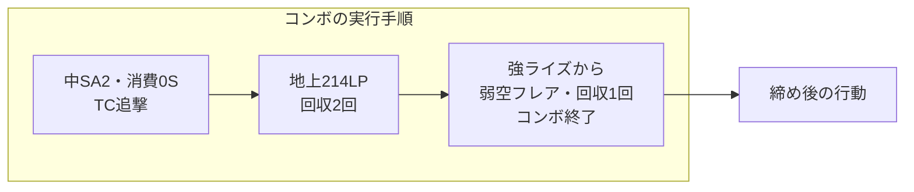

# イングリッド：214214P（SA2）コンボ

[イングリッド](../README.md) › [コンボ](../combos.md) › SA2

[発動の条件](../moves.md#sun-order) · [設置後の攻め](../pressure.md#sa2-pressure)
· [表裏の続き](../okizeme.md#sa2-crossup) · [記法](../../notation.md#move-variants)

**始動から探す索引と、目的から探す索引を分ける。** 本文は主な目的別に並べる。
クラシック入力で記載。公開レシピを整理したもので、本ノートでの実測値とは区別する。

## 始動から探す

| 始動 | レシピ |
| --- | --- |
| `2LK` | [ODライズ → 強・消費0S](#sa2-light) |
| `5MP~MK` | [中・消費0S](#sa2-tc-lv1) / [強・消費1S](#sa2-tc-lv2) / [ODライズ → 中・消費2S](#sa2-tc-lv3) / [中・消費1S → DI](#sa2-di-ender) |
| `DI[PC]` | [中・消費0S → 前ジャンプ](#sa2-di-swap) |
| `5HK[2段目]` | [強・消費0S / 消費1S / 消費2S](#damage-hk) |
| `214214MP[消費0S]` | [SA2発動後からの手順](#crossup-route) |
| `214214HP[消費2S]` | [無敵技ガード後の生発動](#raw-punish) |

## 目的から探す

| 得たいもの | 見るところ |
| --- | --- |
| Sを回収する | [回収型](#stock-recovery) |
| 体力ダメージを取る | [火力比較・生発動からの反撃](#damage) |
| 相手と位置を入れ替える | [前ジャンプでの入れ替え](#position-swap) |
| 相手のDゲージを削る | [コンボ中のDI締め](#drive-drain) / [ガード発動の連係](../pressure.md#sa2-pressure) |
| 次の起き攻めで崩す | [前j.MK締めからの表裏](#okizeme-purpose) |

## 条件と数値の読み方

- `214214MP[消費0S]`は中入力・Sを使わない指定。`214214HP[消費1S]`は強入力・1Sを使う指定。
- ボタン強度とS消費は別条件。どの消費Sを選んでも、SAゲージは2本使う。
- `OD.236K[3段目]`は、ODライズの3段目からSA2へキャンセルする指定。
- `214LP[回収2回]`等は、ホールドによる回収回数。SA2の消費Sとは区別する。
- SA2弾がつなぐ途中の回収・空振り・位置調整は実行手順に含める。最終ヒット後の行動は別記する。
- Dは技列から数えた消費量。自然回復を含む最終残量ではない。
- Sは消費と回収行動の回数を分ける。所持上限4Sによるあふれを差し引いた実収支とは区別する。

出典が全接続を「>」で書いている箇所は、SA2弾の途中ヒットも含めた順序として読む。
回収や移動を含む実行タイミングは元動画と照合する。位置の限定がない資料も、全距離・全相手での成立を保証するものではない。

<a id="from-hit"></a>
<a id="stock-recovery"></a>

## Sを回収する

出典：[拓・2026-08-18](https://note.com/takukakugamer/n/ndcc8238bc070)。
以下の合計ダメージは同じ始動・条件での値を確認できていないため、数値を埋めない。

<a id="sa2-light"></a>

### 小技 → ODライズ → 強・消費0S

```text
2LK > 2LP:OD.236K[3段目]:214214HP[消費0S]
> 2HP:236MK > 214LP > 236HK > j.214LP
```

- 開始0Sから。S消費0・回収2回。D2、SAゲージ2本。
- 小技からODライズを経由する形。ODライズから発動した後の2HPを使い、通常技直接発動と区別する。

<a id="sa2-tc-lv1"></a>

### TC → 中・消費0S：S回収を重視

```text
5MP~MK:214214MP[消費0S] > 5MP~MK
> 214LP[回収2回] > 236HK > j.214LP
```

- 開始0Sから。S消費0・回収3回。D0、SAゲージ2本。
- 途中の地上回収2回と弱空フレアでSを得る。SA2発動後部分だけの参考ダメージを、始動込みの値として使わない。

地上回収も、SA2弾がつなぐコンボ手順の途中に含まれる。左から右へ読む。図は手順の区切りを示し、弾の全ヒット時刻は表さない。



途中の回収を、[最終ヒット後の起き攻め・回収](../okizeme.md#after-ender)と混同しない。

<a id="sa2-tc-lv2"></a>

### TC → 強・消費1S：中ライズを挟んで回収

```text
5MP~MK:214214HP[消費1S] > 5MP:236MK
> 214LP[回収2回] > 236HK > j.214LP
```

- 開始1S以上。S消費1・回収3回。D0、SAゲージ2本。
- 強入力・消費1Sの指定。中入力へ置き換えず、SA2後の5MPから中ライズを使う。

<a id="sa2-tc-lv3"></a>

### TC → ODライズ → 中・消費2S：回収量を増やす

```text
5MP~MK:OD.236K[3段目]:214214MP[消費2S]
> 5MP~MK > 214LP[回収3回] > 236HK > j.214LP
```

- 開始2S以上。S消費2・回収4回。D2、SAゲージ2本。
- 3回回収するための拘束時間を消費2Sで作る。消費0Sの手順とは分けて練習する。

<a id="damage"></a>

## 体力ダメージを取る

<a id="damage-hk"></a>

### 5HK始動：強発動の消費S別火力比較

出典：[かにチャーハン・Ver.2.0301.001](https://note.com/kani_chahan/n/n6d07dbcda977)。
2026-07-23更新の**調整前の参考値**。原文の「5HK始動」「SA2は全て強発動」を合わせて完全入力にした。
現行版の再実測値ではない。開始Sと消費Sを変え、火力・回収の比較候補として残す。

#### 開始0S・強・消費0S：掲載ダメージ3,430

```text
5HK[2段目]:214214HP[消費0S] > 5MK:236MK
> 214LP > 236HK > j.214LP
```

S消費0・回収2回。D0、SAゲージ2本。中央の掲載値。

#### 開始1S・強・消費1S：掲載ダメージ3,710

```text
5HK[2段目]:214214HP[消費1S] > 5MP:236MK
> 214LP[回収2回] > 236HK > j.214LP
```

S消費1・回収3回。D0、SAゲージ2本。中央の掲載値。

#### 開始2S・強・消費2S：掲載ダメージ4,270

```text
5HK[2段目]:214214HP[消費2S] > 5MK:236MK
> 214LP[回収3回] > 6HP:j.214MP
```

S消費2・回収3回。D0、SAゲージ2本。中央の掲載値。
最後は弱空フレアではなく、6HPから中空フレアへつなぐ型。

<a id="raw-punish"></a>

### 無敵技ガード後：強・消費2Sの生発動

出典：[かくぶろ・SA2生発動の反撃](https://takukakugamer.com/sf6-ingrid-combo/)。
画面端・無敵技ガード後の候補として参照する。[発動動作と弾発生](../moves.md#sun-order)を分け、
発動後のODライズが反撃猶予内に届くことまで確認する。

```text
214214HP[消費2S] > OD.236K
> 214LP[回収3回] > 236HK > j.214MP
```

開始2S以上。S消費2・回収3回。D2、SAゲージ2本。ダメージは未実測。
相手のすべての無敵技へ確定する反撃としては扱わない。

<a id="di-and-position"></a>
<a id="position-swap"></a>

## 相手と位置を入れ替える

出典：[拓・2026-08-18](https://note.com/takukakugamer/n/ndcc8238bc070)。
ヒット中の移動と、コンボ後の表裏を区別する。入れ替え後のコマンドは向きに合わせて反転する。

<a id="sa2-di-swap"></a>

### DIパニカン → 中・消費0S：前ジャンプで入れ替え

```text
DI[PC] > 5HK[2段目]:214214MP[消費0S] > 5MP~MK
> 214LP > 9 > 着地 > 236HK > j.214LP
```

- 開始0Sから。S消費0・回収2回。D1、SAゲージ2本。
- 前ジャンプで相手の反対側へ回る。ジャンプ・着地は位置調整で、ジャンプ攻撃を追加したルートではない。
- ダメージは未実測。入れ替えと後続の強ライズが成立する距離・タイミングを確認する。

<a id="drive-drain"></a>

## 相手のDゲージを削る

出典：[拓・2026-08-18](https://note.com/takukakugamer/n/ndcc8238bc070)。

<a id="sa2-di-ender"></a>

### TC → 中・消費1S → DI締め

```text
5MP~MK:214214MP[消費1S] > 5HK > 5LP
> 214LP > 5MK:DI
```

- 開始1S以上。S消費1・回収1回。D1、SAゲージ2本。
- 出典ではDI後+26F・近距離ダウンの例。通常のDIヒットや別Lvの終了状況とは分ける。
- ダメージは未実測。相手Dを削る目的の候補として扱い、削り量を任意に合算しない。

ガード中のD削りは[SA2設置中の攻め](../pressure.md#sa2-pressure)を参照。

<a id="okizeme-purpose"></a>

## 次の起き攻めで崩す

<a id="crossup-route"></a>

### 中央の前j.MK締め

出典：[拓・2026-09-18](https://note.com/takukakugamer/n/n759cb3a115bd)。
ここは**SA2発動からの手順**。発動前の通常技を加えたダメージ・コストとは区別する。

```text
214214MP[消費0S] > 5MP~MK > 214LP > 5LP > 9 > j.MK
```

- 開始0Sから。S消費0・回収1回。発動後部分のD0、SAゲージ2本。
- 中央で前j.MKを締めに使う。ダメージは、同条件の合計値を確認できていないため未記載。
- 締め後の位置調整・着地後5MP・投げなどは[起き攻め側](../okizeme.md#sa2-crossup)へ。ここから先は新しい読み合い。

## 次に増やしたい条件

- 弱入力`214214LP`を使う具体的なルート。
- 投げが成立した後の追撃と、投げ抜け・無敵行動への分岐。
- 端到達のタイミングで変わる追撃、現行版のダメージ・締め後F。
- ガード発動からのBO相手への体力削り。D削りと体力削りを別に測る。

## 参照

調査日：2026-11-03。公開日・更新日を併記し、パッチ対応が不明なものを現行版での確認済み情報とはしない。

- [拓：SA2コンボについてあれこれ](https://note.com/takukakugamer/n/ndcc8238bc070) — 2026-08-18。
- [拓：SA2コン、これだけで良くないですか？](https://note.com/takukakugamer/n/n759cb3a115bd) — 2026-09-18。
- [かにチャーハン：SA2ダメージ重視](https://note.com/kani_chahan/n/n6d07dbcda977) — Ver.2.0301.001、2026-07-23更新。
- [かくぶろ：コンボ](https://takukakugamer.com/sf6-ingrid-combo/) — 2026-09-16更新。
