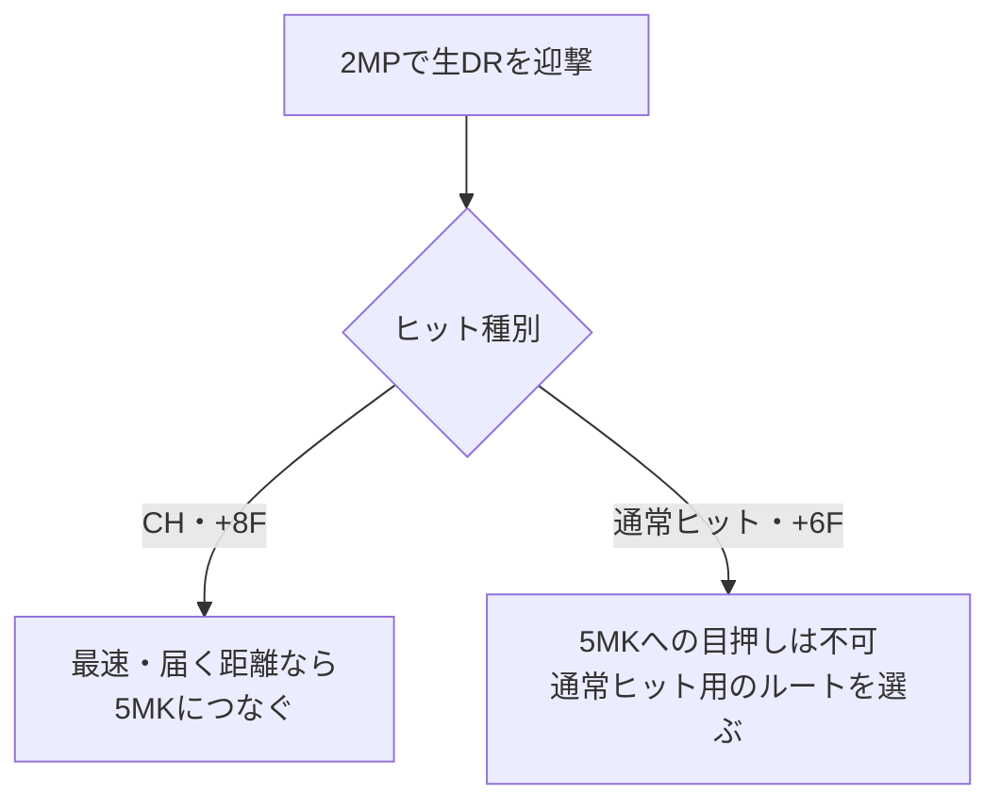

# イングリッド：地上戦

[イングリッド](README.md) › [使い方](README.md#gameplay) › 立ち回り

[戦略の比較](strategy.md) · [相手への対策](matchups/README.md) · [技データ](moves.md)

**距離と相手の行動から、接触・迎撃・距離維持・回収を選ぶ。** 距離の境界は固定座標ではなく、相手のどの行動が届くかで考える。

ここは各戦略で使える行動候補の置き場。[D削り・端攻め](strategies/pressure-and-corner.md)では接触や前進、[S蓄積・大火力](strategies/stock-and-burst.md)では回収機会や接触リスクを主に評価する。

判断の土台は[SF6共通基礎](../fundamentals.md#neutral)へ。
以下の狙いの決め方とD運用は、あくあ総研の一般講座をイングリッドの既存ルートへ当てはめたもの。

## その試合で狙う入口と、待つ行動を決める

**対戦前に、触る技と、その後に得たい展開を一組選ぶ。**
例えば`DR > 5HK`なら、ヒットは[TCからコンボ](combos.md#route-dr5hk)、
ガードは[+2Fの択](pressure.md#dr5hk-guard)へ進むところまで用意する。
歩きから触るなら、5MK・2MKなどのうち何を狙うかを決める。

自分から触らない時間は、相手のジャンプへの`236LK`、生DRへの`2MP` / `5LK`など、
待つ行動を絞る。S回収を優先するときも、相手の接近を止める距離と手札を残す。
どちらの戦略でも、最初からすべての技を同時に狙う必要はない。

共通の考え方と出典：[入口・ゴール・待つときの手札](../fundamentals.md#gameplan)。

## 距離別の早見表

| 距離・目的 | 主な行動 | 選ぶ理由 |
| --- | --- | --- |
| 遠距離：準備 | `236P` / `214LP` | 弾で制限し、S回収や前進の時間を作る |
| 中遠距離：接触 | `2HP` / `5HP` / `5HK` | リーチを使う。キャンセル可否を意識 |
| 中距離：歩きを止める | `5MK`、後退には`2MK` | 接触と下段を使い分ける |
| 近距離：迎撃 | `2MP` / `5LK` / `2LP` | リターンと発生の速さを選ぶ |
| 相手のジャンプ | `236LK` / 空対空 | 地上の置き技・弾を減らして対空を待つ |

## 距離別の立ち回り

### 遠距離：弾とS回収

**弾を出すことより、相手を動かして位置・Sを得ることが目的。** サンシュートは全体動作が長いため、高速DRや弾抜けが届く距離では頻度を落とす。

| 相手の選択 | こちらの回答候補 | 得たい結果 |
| --- | --- | --- |
| 通常ガード | 弾で制限し、前進か距離維持・回収機会を選ぶ | D削り・位置・準備時間 |
| パリィ | 連射を減らし、前歩きや回収機会を選ぶ | 位置・S。近距離では投げも候補 |
| ジャンプ | 弾を控えて対空 | ダウン・次の準備時間 |
| DR・突進 | `2MP` / `5LK`で迎撃、間に合わなければガード | 接近を止める |
| 弾抜け | 弾を出さず硬直を誘う | 失敗した弾抜けへ反撃 |
| 後退 | 設置・回収、または前進を選ぶ | 準備時間、または端への追い込み |

触れたら[ヒット・ガード分岐](pressure.md#dr5hk)、ダウンを取ったら[S回収・弾・起き攻め](okizeme.md#after-ender)へ。

### 中遠距離：長い通常技

| 技 | 性質 | 注意点 |
| --- | --- | --- |
| `2HP` | 12F、ガード-1F、必殺技キャンセル可。D削り0.50本 | 空振り・出掛かり。キャンセル先までDIに安全とは限らない |
| `5HP` | リーチ最長級。差し返し・前進制止 | 通常必殺技キャンセル不可、全体35F |
| `5HK` | 9F、ガード-2F。置き・ヒット後の展開 | 通常必殺技キャンセル不可、全体36F |

相手が置き技を増やしたら、間合いを出入りして空振りを誘う。差し返し待ちに接近を選ぶなら、技を置かず歩く。
距離を保つ利益は、回収機会と失う位置を含めて[戦略側](strategy.md#comparison)で比較する。

### 中距離：接触と下段

- **`5MK`**：8F、ガード-3F。歩きに接触させ、214P系へつなぐための技。
- **`2MK`**：8F、下段、ガード-6F。後ろ歩きを咎めたいときに選ぶ。
- **`2MP`**：7F、ガード-1F。届く距離ならヒットリターンを狙う。

接触を狙う場合は、相手が振るなら空振り誘い、振らなくなったら前進・5MK、後退するなら下段。
距離を保つ場合は[S蓄積案の準備](strategies/stock-and-burst.md)を参照。
[中距離コンボ](combos.md#route-mid) / [強化フレアのガード後](pressure.md#enhanced-pressure)

### 近距離：速さとリターン

| 技 | 主な使い方 |
| --- | --- |
| `2MP` | DR止めの本命。CHから5MKへつなぐ |
| `5LK` | 5F発生で、迎撃の速さを優先 |
| `5MP` | 6F、ガード±0。近距離接触・TCへの移行 |
| `2LP` | 4F、ガード-1F。素早い反応・暴れ |

判定やリーチによって結果は変わる。強化フレア等で有利を取っても投げが届くとは限らないため、[接触後の攻め](pressure.md#enhanced-pressure)で距離も見る。

## 待つ相手へキャンセルDRで触る

**ジャンプや生DRを返され続けるなら、届く通常技からのDRCも比較する。**
イングリッドでは[2MK・2MP・5MKの既存ルート](combos.md#route-drc)が入口になる。
DRCは3Dを使うため、相手に触る前のD残量と、触った後に何を得るかを決めて使う。

ヒット時のコンボとガード時の択を分け、DRC後も打撃の隙間・投げ間合いを確認する。
接触が終わったら、さらにDRCを重ねるか、対空・DR迎撃を意識してDを戻す時間を作るかを選ぶ。
S補充とD回復は別の目的なので、回収に移る場合は相手の接近と失う位置も見る。

共通の考え方と出典：[接触への投資と回復する時間](../fundamentals.md#drive)。

## 相手の動きに合わせる

### ジャンプを落とす：対空と、その後の追撃を分ける

**まず飛びを落とし、当たった高さで追撃と次の準備を選ぶ。**
普段の弱ライズと、早めに構える4HP、空対空を使い分ける。

| 入力 | 選ぶ場面 | 通った後・注意点 |
| --- | --- | --- |
| `236LK` | 弱ライズが届いて間に合う飛び | 対空無敵を使う。単発で落とした後の位置を確認 |
| `4HP~HP` | 早めに見えた飛び、頭上・遠めの飛びを拾う候補 | 1段目は14F。TC後の追撃は接触高さで変わる |
| `j.HK~HK` | 空対空を先に狙う | 2段目の遅らせと、着地後に拾う高さを確認 |
| `236HP` | 先に弾を置き、ジャンプの軌道を制限する | 空中ヒットなら生DR追撃を比較。飛びを見てからの対空とは別 |

4HPの発生と対空の例は[かくぶろ](https://takukakugamer.com/sf6-ingrid-combo/)、
空対空は[ドス](https://note.com/dos236236/n/nd3f3300416b7)を参照。
同じ技でも当てた高さによって拾いが変わるため、[対空・空中ヒットの完全入力](combos/air.md)と
[対空後の次の行動](okizeme.md#after-air-impact)を一組で練習する。

強弾の空中ヒットからDRで拾う動きは、
[shimantの2026-10-26の実践記](https://note.com/shimant/n/n5663de394f93)にも記述がある。
同記事はMR1550〜1600帯での個人の使用感で、全距離で安全に弾を置けるという性能値ではない。
相手の弾抜け・DR・ジャンプの軌道まで含めて頻度を決める。

### 生DRを止める：2MPを本命、5LKを補完

| 技 | 発生・持続 | 通常 / CHヒット | 空振り全体 |
| --- | --- | --- | ---: |
| `2MP` | 7F・4F | +6F / +8F | 25F |
| `5LK` | 5F・3F | +3F / +5F | 18F |

**CH・最速・届く距離なら`2MP > 5MK`が連続ヒット。** 5MKは発生8F。通常ヒット+6Fではつながらず、DRを見たという理由だけでCHにもならない。[完全コンボ](combos.md#anti-dr-combo)

通常ヒット側は[近距離コンボ](combos.md#route-close)へ。ガード・空振りはヒット用の分岐に含めない。

5LKは2F速く、全体動作も短い。反応が遅れる場面や速さが必要な場面を補う。2MPの判定の強さは使用感に基づく仮説で、相手ごとの判定勝ちを保証するものではない。

### 戦略に応じて優先順位を変える

下表は各案で比較する狙い。技の性能と、どちらを選ぶかの判断を分ける。[戦略の比較](strategy.md#comparison)

| 状態 | D削り・端攻め案 | S蓄積・大火力案 |
| --- | --- | --- |
| 自分のSなし | ダウンから回収。ODフレアの有利には2D必要 | 接触前の距離維持でも回収機会を探す |
| Sあり・相手D少 | 接触から強化フレアの圧力を重視 | 準備継続と高火力への変換、D削りの利益を比べる |
| 相手が端 | 大きく下がらず、脱出阻止・再接触 | 回収の利益と、位置を手放す損失を比べる |
| 相手BO | ガード硬直+4Fを使う。DIへのジャンプ・SAも意識 | 回復までの時間を圧力と一撃の準備にどう使うか比べる |

#### 相手の行動への回答候補

| 相手の回答 | こちらの候補 |
| --- | --- |
| 相手がDIを見せる | キャンセルDI・様子見・投げ等。キャンセル不能技の頻度を調整 |
| 相手が無敵技を使う | 誘ってガード → [確定反撃](punish.md#reversal) |
| 相手が投げ抜けを使う | シミー → [投げ空振り反撃](punish.md#shimmy) |

## 接触した後

- `DR > 5HK`がヒット → [コンボ](combos.md#route-dr5hk)、ガード → [+2Fの攻め](pressure.md#dr5hk-guard)。
- 投げが通る → [投げ後](okizeme.md#after-throw)。
- コンボで倒す → [締め別の次入力](okizeme.md#after-ender)。

## 参照

- [技性能・判定の参照先](moves.md)
- [UFD：Ingrid](https://ultimateframedata.com/sf6/ingrid)
