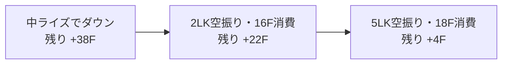
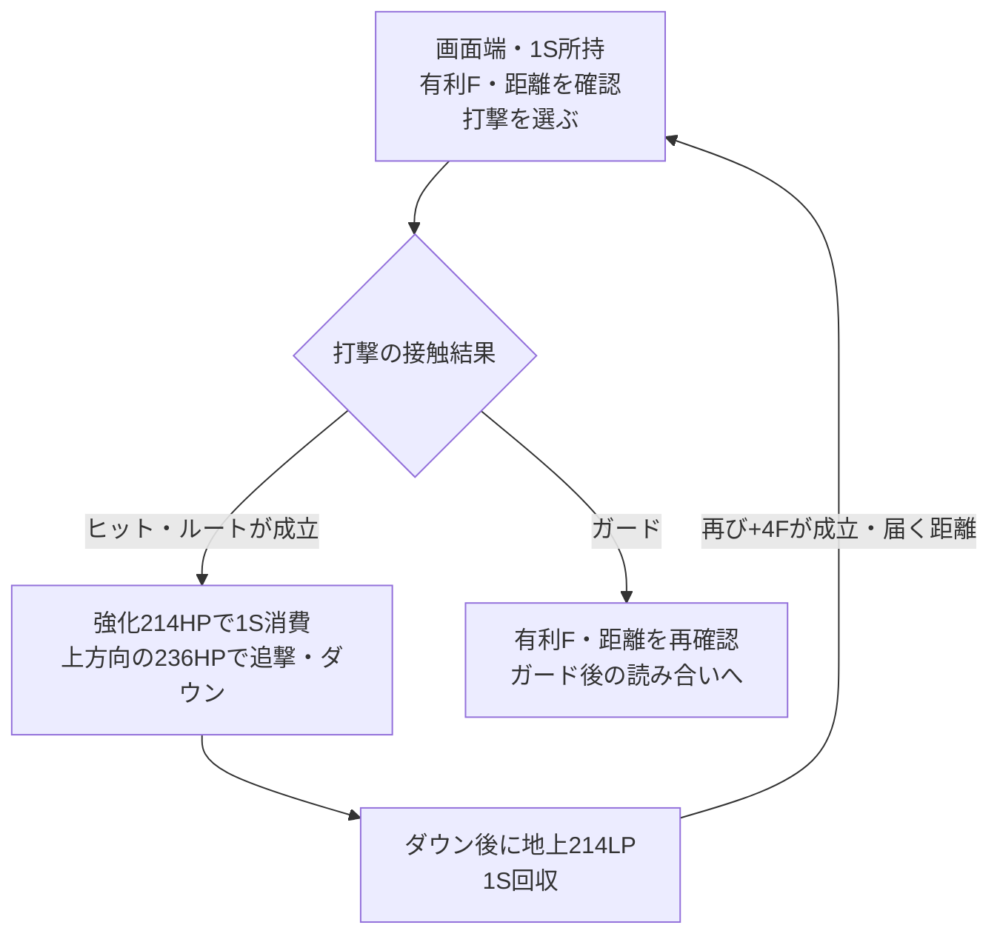
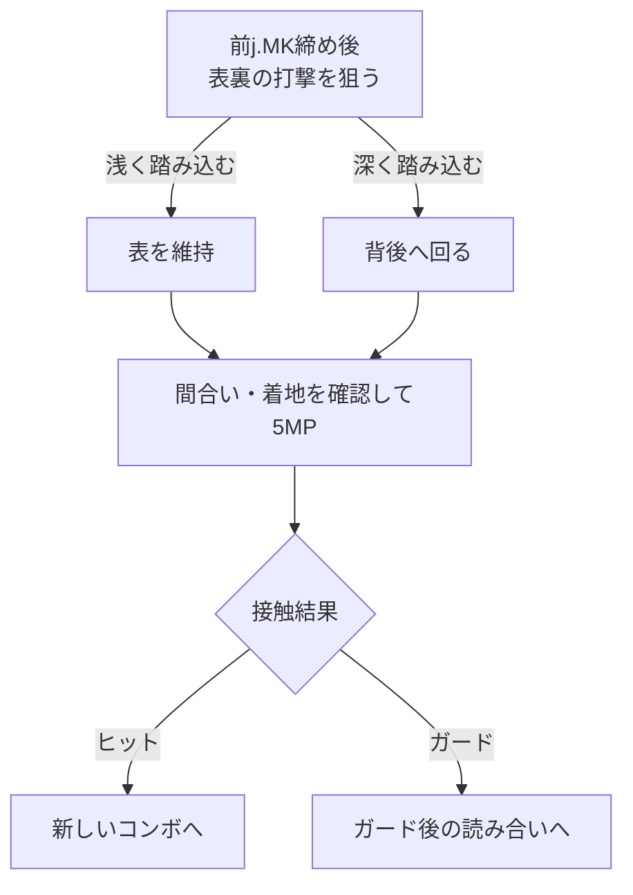

# イングリッド：起き攻め

[イングリッド](README.md) › [使い方](README.md#gameplay) › [攻め](README.md#offense)

[ガード後の攻め](pressure.md) · [コンボ](combos.md) · [技データ](moves.md)

**ダウンを取ったら、接近・弾重ね・S回収のどれを取るか選ぶ。** 有利Fは締め・高度・距離で変わるため、以下は条件付きの目安。

同じダウンでも、端圧力を続ける利益と、Sを回収して再準備する利益を[各戦略](strategy.md#comparison)で比べる。

時間調整と重ねを一組で覚える考え方は[セットプレイの共通基礎](../fundamentals.md#setplay)へ。

[投げ後](#after-throw) / [端の前投げ→中弾](#throw-projectile)
/ [締め別の次入力](#after-ender) / [端のS回収ループ](#corner-loop)
/ [中ライズ後のDR弱弾](#rise-dr-projectile) / [SA2の表裏](#sa2-crossup)

## 時間調整の基準

`残りF = ダウン後有利F - 時間調整に使う行動の全体F`

| 行動 | 消費時間 |
| --- | ---: |
| 前ステップ・`66` | 20F |
| 地上S回収・`214LP` | 48F |
| `2LK(w)` | 16F |
| `5LK(w)` | 18F |

時間が余っても、打撃・投げが届くとは限らない。早過ぎる入力や起床時の投げ無敵にも注意する。

<a id="after-throw"></a>

## 通常投げ後

| 結果 | ダメージ | ダウン後有利F | 最速前ステ後 |
| --- | ---: | ---: | ---: |
| 前投げ | 1,200 | +21F | +1F |
| 後ろ投げ | 1,200 | +20F | ±0F |
| パリィ等へのPC投げ | 2,040 | ハードダウン | 通常投げのFは流用しない |

<a id="throw-dash"></a>

### 前投げ → 66

**最速前ステで+1F。届く4F小技なら、相手の最速4Fより1F先行する。** 投げは5Fなので、4F暴れに一方的に勝つ投げループではない。

ガード・パリィを読むなら投げも候補。中央では弾設置・DRで再接近する選択もある。打撃が当たれば[小技コンボ](combos.md#route-close)、投げが通れば[投げ後](#after-throw)へ戻る。

<a id="throw-projectile"></a>

### 端・前投げ → 微歩き → 236MP

**前投げ後、微歩きを挟んで中サンシュートを出す。微歩きが必要なことはトレモで確認済み。**

```text
前投げ > 微歩き > 236MP
```

有利Fは持続の当たり方で変わる。ガード+6F・ヒット+10Fは例で、固定値・上限ではない。確認済みの入力条件と、この数値の目安を区別する。

| 弾の結果 | 有利Fの例 | 次の候補 |
| --- | ---: | --- |
| ヒット | +10F・可変 | 10F以上あれば[2HK追撃](#ender-twohk)候補。届くことも条件 |
| ガード | +6F・可変 | 届く2MPで4F暴れを潰す、投げ、シミー → [攻めの分岐](pressure.md#projectile-plus6) |
| パリィ | 通常ガードと別 | 投げ・ライン維持などの読み合い |
| 無敵技・SA・弾抜け | キャラ・発生次第 | 設置自体を咎められる可能性 |

<a id="ender-twohk"></a>

#### 中弾ヒット → 2HK

**弾ヒットで+10F以上取れ、届けば、発生10Fの2HKが追撃候補。** 弾の基礎ダメージ700、2HKは900だが、補正込みの合計は未実測。

2HKダウン後約+30Fの報告例では、前ステ後約+10F。実際の有利F・距離で時間調整し、[打撃・投げ・シミー](pressure.md#corner-pressure)を選ぶ。

<a id="throw-dr5hk"></a>

### 端・前投げ → DR > 5HK

**1Dを使って再接近する。** 持続重ねの報告例はヒット+9F / ガード+2F。

ヒットなら[TCからコンボ](combos.md#route-dr5hk)、ガードなら[+2Fの択](pressure.md#dr5hk-guard)。ジャストパリィや無敵技が成立したら同じ攻めは継続できない。

<a id="throw-light-projectile"></a>

### 端・前投げ → 236LP

**停滞・再射出する弾を使って前進する選択。** 前投げ+21Fに対して弱弾は全体49Fなので、相手の起床前に動作が終わる確定重ねではない。

パリィ・ジャンプ・弾抜け・無敵行動を含めて選ぶ。様子見なら無敵技を誘う機会もあるが、圧力は弱まる。[無敵技をガードした後](punish.md#reversal)

<a id="after-ender"></a>

## コンボ締め別：次の入力

**表の有利Fが取れたルートで使う。** 同じ締めでも高度や距離で変わり、全ルート共通の保証値ではない。[完全コンボ一覧](combos.md)

| 締め・位置 | 参考ダウンF | 次の入力 | 狙う状態 |
| --- | ---: | --- | --- |
| 中ライズ・`236MK` | 約+38F | `66` | +18F。歩き調整→投げ / 2MP / シミー |
| 中ライズ・画面端 | 約+38F | `2LK(w) > 5LK(w)` | +4F → [端の読み合い](pressure.md#corner-pressure) |
| 中ライズ・弾重ね | 約+38F | `5LP(w) > 236LP` | 持続重ねの報告例はヒット約+7F / ガード約+3F |
| 中ライズ・別の重ね | 約+38F | `4MK(w) > dl.2MP` | ヒット約+8F / ガード約+1Fの報告例 |
| 中フレア・`214MP` | 約+47F | `214LP` | S+1、約-1Fで[地上戦](neutral.md)へ |
| 強ライズ→弱空フレア | 約+25F | `66` | +5F。密着なら投げ / 打撃 / シミー |
| 強ライズ→中空フレア | 約+49〜50F | `66 > 66` | +9〜10F。最速の投げ・打撃は早過ぎる場合あり |
| 同上・回収優先 | 約+49〜50F | `214LP` | S+1、約+1〜2F。距離は離れる |

- 中ライズが実ルートで+37F / +40F等なら、時間調整も変える。
- 中フレアの約+47Fと、特定ルートで報告された+54Fは別。後者が成立した場合に限り、回収後約+6F。
- S回収後の残りFと、近距離起き攻めができることを混同しない。

### 中ライズ後：空振り2回で+4Fを作る例

**実ルートで+38F取れた場合の時間調整。** 左から右へ、行動で消費するFと残りFを追う。箱の横幅は時間の長さを表さない。



入力は`2LK(w) > 5LK(w)`。`38 - 16 - 18 = +4F`となった後、届く距離なら[端の択](pressure.md#corner-pressure)を選ぶ。空振りが相手に接触した場合や入力が遅れた場合は、同じ時間調整にはならない。

<a id="rise-dr-projectile"></a>

### 端・中ライズ締め → 生DRから弱弾を重ねる

**画面端で中ライズを締めに使い、ダウン後に生DRから弾を重ねる。**
以下の有利Fは、相手ルークの公開例に基づく未実測の参考値。準備と、その後のヒット確認・連ガ部分を分けて練習する。

```text
条件：画面端・236MKでダウンを取った後
通常弾：DR > 236LP
OD弱弾：DR > OD.236P[弱・LP+MP]
```

| 弾の版 | ガード後の報告値 | ダウン後の追加消費 | 続き |
| --- | ---: | --- | --- |
| 通常弱弾 | +5F | D1、S消費0 | [5MKのCH確認](pressure.md#rush-projectile-plus5) |
| OD弱弾 | +12F | D3、S消費0 | [2HPから中SA2の連ガ](pressure.md#sa2-od-projectile) |

Dはこの準備部分の合計。中ライズまでに使うコンボのD・SA消費は別に数える。
OD弱弾は[LP+MPの同時押し](moves.md#od-sunshoot-input)で指定する。

弾を出すタイミング・距離・ホールド量の固定手順は未確定。参考動画の入力履歴と照合する。
中ライズ締め全般で同じ+5F / +12Fになるとはせず、実際のガード後Fと距離を確認する。
パリィや、弾を出す過程への無敵行動も再生候補にする。

<a id="after-air-impact"></a>

### 対空・DIから締めた後

**対空やDIの始動も含めて実ルートのダウンFを測る。**
通常の地上コンボと同じ締めでも、高さや押し戻しを変えたら時間調整を見直す。

| 場面 | 公開例の目安 | 次の候補 | 確認する条件 |
| --- | --- | --- | --- |
| 弱ライズ対空 | +36F以上の報告 | `66`で接近 | 実際に+36Fなら前ステ後+16F。位置も確認 |
| 高めの4HP対空→6KKK | +44Fの報告 | `66 > 66` | 実際に+44Fなら残り+4F。投げ間合いは別 |
| DI壁やられ→強弾2回 | +42Fの報告 | 詐欺飛び候補を検証 | 相手のガードと最速無敵技への着地ガード |

完全入力は[対空のルート](combos/air.md#anti-air)と
[DI壁やられ](combos/impact.md#wall)へ。
4HP→6KKKは高め拾いの条件付きで、低く当てたときへ+44Fを流用しない。
詐欺飛び候補も、+42Fという数値だけで全キャラの無敵技に対応できるとはしない。

<a id="corner-loop"></a>

## 端：1S強化フレアからSを回収する

**Sを使ってダウンを取り、1Sを戻して次の攻めへ。** 既存メモの中心的なセットプレイ。

```text
条件：画面端・開始1S
コンボ：5MP~MK:214HP > 236HP
ダウン後：214LP（S1回収）
目安：1S所持、起き上がりに対して+4F
```



**S回収はコンボ終了後の準備。** 打撃がガードされた場合は、ヒット用の強弾追撃・回収まで進まない。回収後の条件が整ったら[端の読み合い](pressure.md#corner-pressure)へ戻る。

+4Fは端・ヒット状況・入力タイミングを含む参考値。別始動や遅延入力へは無条件に流用しない。入力は強サンフレアの`214HP`で、`214HK`ではない。

打撃ヒットなら[端コンボ](combos.md#route-corner-loop)からこの準備へ、投げなら[投げ後](#after-throw)、シミー成功なら[PC確反](punish.md#shimmy)へ進む。

<a id="sa2-crossup"></a>

## SA2：前j.MK締め後の表裏

中央の[中・消費0S→前j.MK締め](combos/sa2.md#crossup-route)の後に、位置調整と着地後の選択を加える。

**コンボの終了後に、表裏・投げ・様子見を選ぶ新しい読み合い。** 表裏後のダメージを、元のSA2コンボへ合算しない。

| 締め後に狙うこと | 操作・考え方 | 注意する条件 |
| --- | --- | --- |
| 表から打撃を重ねる | 浅く踏み込み、位置関係を維持して着地後5MP | 間合い・着地のタイミング |
| 裏から打撃を重ねる | 深く踏み込み、相手の背後へ回って着地後5MP | 早過ぎる5MPは逆側へ出る例がある |
| パリィを崩す | 投げを混ぜる | 投げ間合い・重ねのタイミング |
| 投げ抜け・無敵行動を読む | 垂直ジャンプを使うシミー等を比較する | 相手の技とタイミングで相性が変わる |

表・裏の双方で5MPを重ねる参考例。踏み込み量と着地タイミングを含めて再現する。

表裏の打撃を選ぶ場合の流れ。表・裏のどちらでも、接触後はヒット・ガードを確認する。



ヒット後は[近距離コンボ](combos.md#route-close)、ガード後は[攻めの選択](pressure.md#guard-pressure)へ。前のSA2コンボとは分ける。投げを選んで通った場合は[投げ後](#after-throw)へ。

SA2中に強ライズ・空フレア・DIで締める別ルートは、最後にSA2弾が当たるかでも終了状況が変わる。
通常の締めに記載した+25F等をそのまま流用せず、採用したSA2ルートの最終ヒットと距離で確認する。

<a id="参照"></a>

## 出典・参考資料

- [UFD：Ingrid](https://ultimateframedata.com/sf6/ingrid)：
  技の全体F・投げ後の有利Fなど、時間調整に使う技データ。
- [スト6原典：起き攻め](https://sf6-ingrid.com/character/ingrid/category/okizeme-setplay)
  投げ後・コンボ締め後のセットプレイ。
- [SF6 Lab：コンボ・起き攻め](https://sf6-lab.net/en/fighters/ingrid/combo)：
  コンボ締め後の状況と起き攻めの参考資料。
- [absolute ego 湯加減・2026-11-07の投稿](https://x.com/chocosynthesize/status/2118748691695915421)
  （日本時間）：[端・中ライズ締めからの生DR弱弾重ね](#rise-dr-projectile)。
  本文と添付動画に基づく通常弱弾+5F / OD弱弾+12Fの公開例で、相手はルーク。
  弾を出すタイミング・距離・ホールド量の固定手順は本文にない。
- [ドスの公開例](https://note.com/dos236236/n/nd3f3300416b7)：
  [対空・DIから締めた後](#after-air-impact)の弱ライズ+36F以上、
  高めの4HP→6KKKで+44F、DI壁やられ→強弾2回で+42Fの報告値。
- [拓・2026-09-18](https://note.com/takukakugamer/n/n759cb3a115bd)：
  [SA2・前j.MK締め後の表裏](#sa2-crossup)。
  浅い / 深い踏み込みからの5MP、投げ、垂直ジャンプを使うシミーの参考例。
