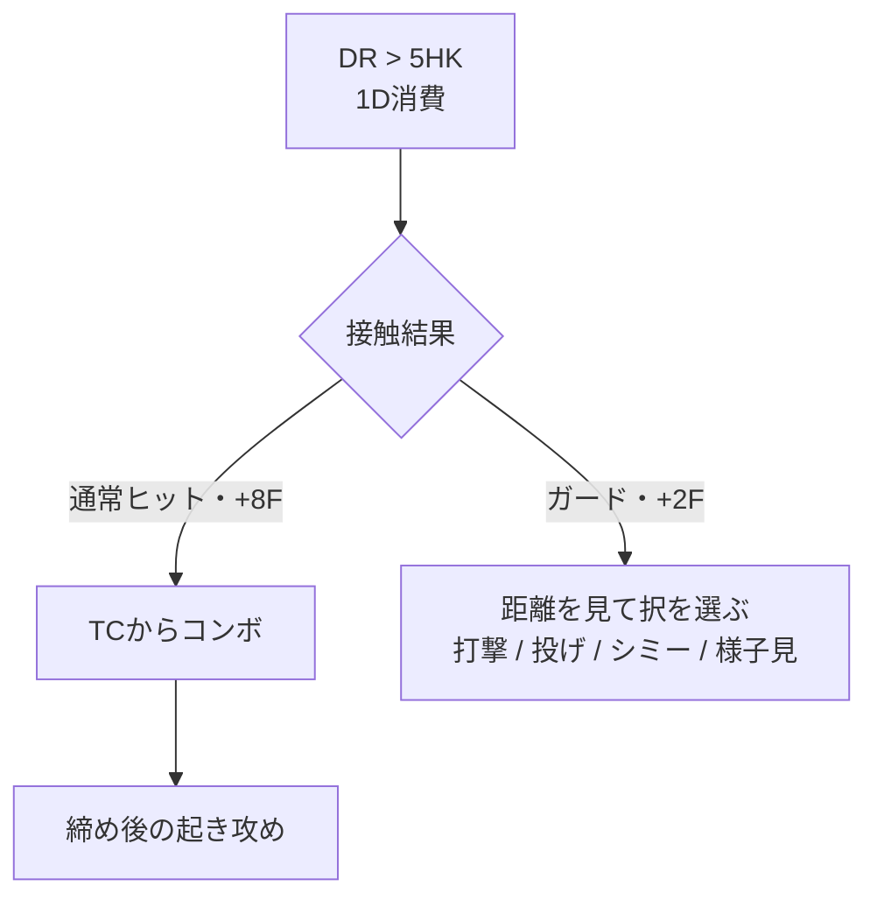
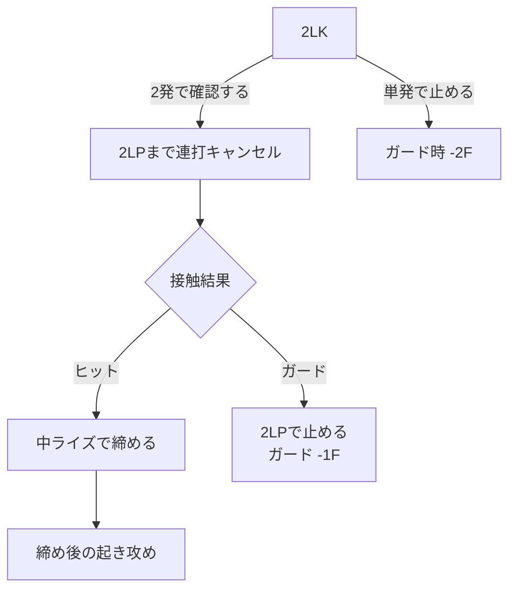
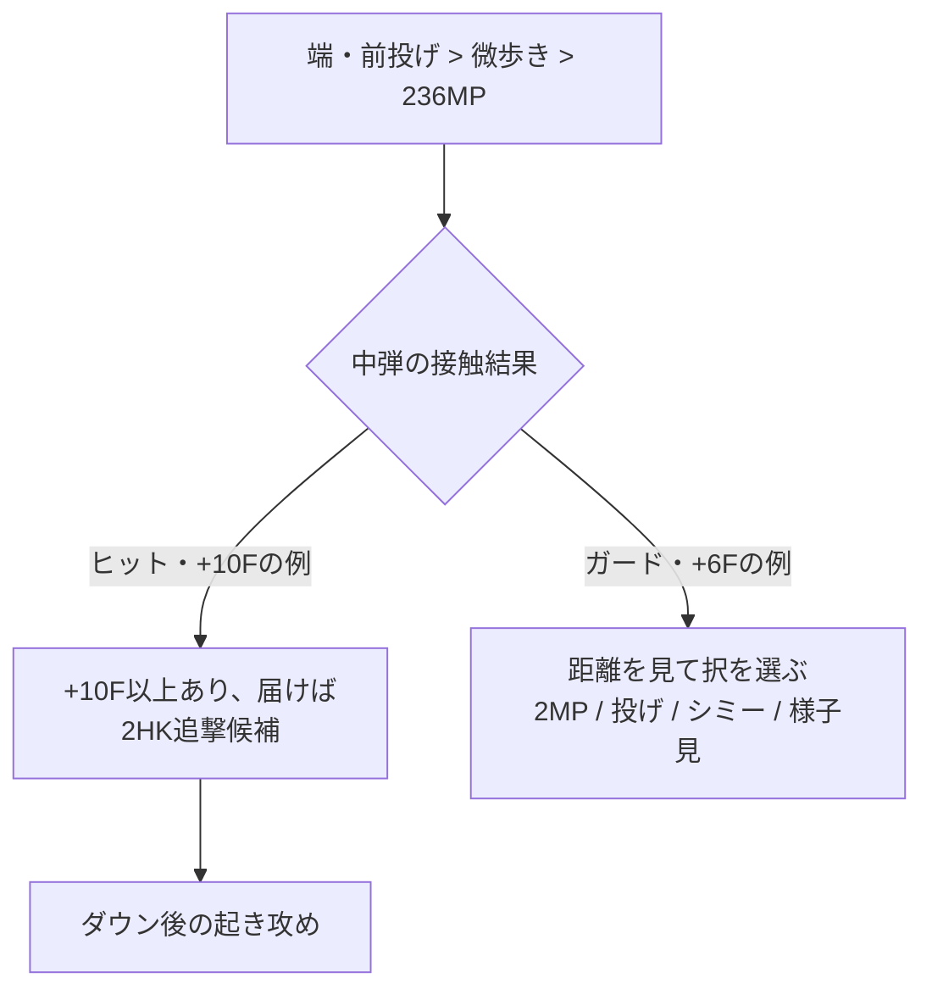
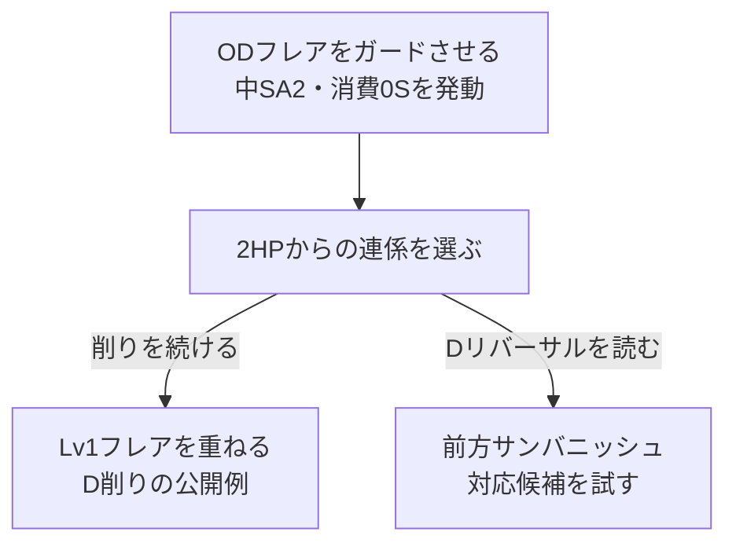

# イングリッド：ガード後の攻め

[イングリッド](README.md) › [使い方](README.md#gameplay) › [攻め](README.md#offense)

[起き攻め](okizeme.md) · [確定反撃](punish.md) · [コンボ](combos.md)

**ガード後は、有利Fと距離から打撃・投げ・シミー・様子見を選ぶ。** 読み合いの表は先に選ぶ択の相性を示す。相手の選択を見てからすべて返せるという意味ではない。

分岐図は上から下へ読む。ひし形は結果・成立条件の確認、四角は行動・次の局面を表す。[図の読み方](../notation.md#flowcharts)

接触した場面での行動候補を記す。接触を狙う頻度やSの投資方針は[戦略の比較](strategy.md)で考える。

## 読みたい場面を選ぶ

| 場面 | 見るところ |
| --- | --- |
| 触った結果を確認する | [DR > 5HKのヒット・ガード分岐](#dr5hk) |
| ガード後に何を選ぶか | [DR強K後の+2F](#dr5hk-guard) / [強化フレア後](#enhanced-pressure) |
| 画面端で攻めを続ける | [+4F後](#corner-pressure) / [中弾後](#projectile-plus6) / [脱出への回答](#escape-counter) |
| SA2を設置して攻める | [ガード発動・D削り](#sa2-pressure) |

数値は[技データ](moves.md)と既存の条件付きセットプレイに基づく。距離・持続・無敵・入力タイミングも成立条件。[記法](../notation.md)

<a id="contact-result"></a>

## 接触結果を確認する

<a id="dr5hk"></a>

### DR > 5HK：ヒットかガードか



ヒット時は[TCからコンボ](combos.md#route-dr5hk) → [締め後](okizeme.md#after-ender)。ガード時は[+2Fの択](#dr5hk-guard)へ。

- 端・前投げからの持続重ねは、ヒット+9F / ガード+2Fの報告例。[投げ後の入力条件](okizeme.md#throw-dr5hk)を参照。
- パリィ / ジャストパリィは図の通常ガードとは別の状況。通常パリィへの投げと、ジャストパリィ反撃を区別する。
- 空振り / 相手の無敵行動では攻めが途切れ、反撃を受け得る。状況に応じて[地上戦](neutral.md)へ戻る。

<a id="guard-pressure"></a>

## ガード後の読み合い

<a id="dr5hk-guard"></a>

### ガード後+2Fで選ぶ択

| 自分の行動 | 狙う相手の行動 | 苦手・注意点 | 通った後 |
| --- | --- | --- | --- |
| `2LK`・5F下段 | 立ちガード、最速4F暴れ | しゃがみガード、パリィ、無敵技 | [小技コンボ](combos.md#route-close) |
| `5LP` / `2LP`・4F | 最速4F暴れ、投げ抜けの出掛かり | ガード、間合い外、無敵技 | [通常 / CHコンボ](combos.md#route-close) |
| 通常投げ・5F | ガード、通常パリィ、4F暴れ | 投げ間合いが必要。投げ抜け、ジャンプ、バクステ、無敵技 | [投げ後](okizeme.md#after-throw) |
| `5MP`・6F | 遅い暴れ、投げ抜け行動 | 最速4Fと相打ちし得る。無敵技 | ヒット・距離を見てTCへ |
| `2MP`・7F | 固まる相手、遅らせ行動 | 最速4Fに負ける。無敵技 | [ヒット後のコンボ](combos.md#route-close) |
| シミー・後ろ歩き | 即 / 遅らせ投げ抜け | 打撃・下段。相手がガードなら直接のリターンなし | [投げ空振り反撃](punish.md#shimmy) |
| ガード・様子見 | 無敵技・SA | 相手の投げ。ガード継続には直接のリターンなし | [ガード後の確反](punish.md#reversal) |

+2Fから、5F行動は最速4Fより1F先行、4F行動は2F先行する関係。先端まで投げ・シミーが成立するとは限らない。

#### 小技を選んだ後

**ヒット確認して締める。ガードなら中ライズを入れ込まない。** 中ライズはガード-23F。

`2LK`始動で2発確認する場合：



ヒット時は[2LP経由のルート](combos.md#route-close) → [締め後](okizeme.md#after-ender)。3発届くなら[5LP・5LK経由](combos.md#route-close)も選べる。

- `5LP`通常ヒットは+5F → 届けば`5LK:236MK`等。ガード-1F。
- `2LP`通常ヒットは+4F → 5Fの5LKへの目押しを前提にしない。CHなら+6Fから5MP~MKが候補。ガード-1F。
- パリィなら下段では崩せない。次の読み合いで投げを混ぜる。無敵技を使う相手には様子見も選ぶ。

#### 投げ・シミー・様子見を選んだ後

- **投げ成功** → [通常前後投げ / パリィPC投げ後](okizeme.md#after-throw)。投げ抜けなら0ダメージで離れる。
- **シミー成功** → 投げ空振りを確認して[5MK[PC] / 5HK[PC]](punish.md#shimmy)。
- **無敵技・SAをガード** → [届く確反](punish.md#reversal)。

<a id="enhanced-pressure"></a>

### 強化214HP / OD214Pをガードさせた後

**有利を使って再接触する。離れていれば歩き・牽制を優先する。**

1Sの214HP、0SのOD214Pはいずれもガード+4〜+8F。S別の詳しい値は[フレアの表](moves.md#sunflare)を参照。

ガードだけではSは戻らない。ヒット後に強弾→回収へ進む[端ループ](okizeme.md#corner-loop)と、ガード後の攻め継続を区別する。

<a id="corner-offense"></a>

## 画面端での攻め

<a id="corner-pressure"></a>

### +4Fを得た後

**打撃で暴れを抑え、ガード・パリィには投げ、投げ抜けにはシミーを混ぜる。**

| 自分の行動 | 狙い | 続き |
| --- | --- | --- |
| `5MP~MK`等の打撃 | 4F暴れ・投げ抜け行動を潰す | [端コンボ](combos.md#route-corner-loop) → [S回収](okizeme.md#corner-loop) |
| 投げ | ガード・パリィを崩す | [投げ後](okizeme.md#after-throw) |
| シミー | 遅らせ投げ抜けを空振らせる | [PC反撃](punish.md#shimmy) |
| ガード・様子見 | 無敵SA・Dリバーサルを誘う | 実際にガードできた技へ[確反](punish.md#reversal) |
| 下段・前歩き | 後ろ歩きを咎め、再接触 | 距離に応じて攻めを継続 |

6Fの5MPは+4Fから最速なら4F暴れに勝つ関係。ただし届くことが前提で、TC2段目のヒットまで保証しない。

入口の例は[1S強化フレア→強弾→S回収](okizeme.md#corner-loop)。**有利F、投げ間合い、ヒットからループに戻れるか**はそれぞれ確認する。

<a id="projectile-plus6"></a>

### 中弾をガードさせた後：+6Fの例

**+6Fなら、届く2MPで最速4F暴れに勝つ関係。** 近距離なら投げ・シミーも候補。

[前投げ→微歩き→236MP](okizeme.md#throw-projectile)の有利Fは接触持続で変わる。+6Fは固定値・上限ではない。押し戻しで投げ間合いを外れる可能性もある。



弾ヒット側の条件とダウン後の行動は[2HK追撃候補](okizeme.md#ender-twohk)へ。パリィ・無敵技・弾抜けは[中弾設置の分岐](okizeme.md#throw-projectile)を参照。

ガード後に選んだ択が通ったら：

- 2MPヒット → [コンボ](combos.md#route-close) → [締め後](okizeme.md#after-ender)。ガードならヒット用のコンボを入れ込まない。
- 投げ成功 → [投げ後](okizeme.md#after-throw)。
- シミー成功 → [投げ空振り反撃](punish.md#shimmy)。
- 無敵技ガード → [確反](punish.md#reversal)。

<a id="escape-counter"></a>

### 脱出しようとする相手への回答

| 相手が選びやすい行動 | こちらが混ぜる候補 |
| --- | --- |
| ガード・パリィ | 投げ、届く打撃 |
| 4F暴れ | 有利を使った打撃重ね |
| 遅らせ投げ抜け | シミー |
| バクステ・ジャンプ | 届く打撃、対空、位置維持 |
| OD無敵技・SA | ガード、間合い外で様子見 |
| Dリバーサル | 使われる局面でガード・回避 |
| DI返し待ち | DIの入れ込みを減らす |

<a id="sa2-pressure"></a>

## SA2設置中の攻め

**ガード発動からDを削る連係と、投げ・表裏で崩す読み合いを分ける。**
ヒット時の入力は[SA2コンボ](combos/sa2.md)、前j.MK締め後は[起き攻め](okizeme.md#sa2-crossup)へ。

以下の公開例には、D削りを続ける択と、Dリバーサルを読む択がある。**相手の行動を見てから一律に切り替える図ではなく、先に選ぶ連係の分岐。**



開始S・入力と未特定の強度は下の各レシピを参照。Dリバーサルへの対応も、距離・技・タイミングで結果が変わる。

### ODフレア → 中・消費0S：D削りの公開例

出典：[かくぶろ・セットプレイ](https://takukakugamer.com/st6-ingrid-setup/)（2026-09-02更新）。
ODフレアをガードさせるところからの手順。始動前の通常技は含めない。

```text
OD.214P[S消費1]:214214MP[消費0S]
> 2HP:214P[Lv1・MP/HP未特定]
> 2HP:214P[Lv1・MP/HP未特定] > 5MP
```

- 開始1S、ODフレアで1S消費。SA2は0S消費。D2、SAゲージ2本。
- 原文は後半を「サンフレアLv1」と記載し、MP/HPを指定していない。その不明点を残して採録する。
- 原文では最速入力で連続ガード・約3.5D削りの例。本ノートの実測値ではなく、同じ始動・距離・強度で再現するための参考値。
- Dリバーサルを使われる分岐も含む。連続ガードという記載を、相手の全防御手段を封じる意味にしない。

### Dリバーサルを読む分岐

同じ出典では、2HPに合わせたDリバーサルを狙う相手への回答候補として、次の入力が挙げられている。

```text
OD.214P[S消費1]:214214MP[消費0S] > 2HP:6KKK
```

削り連係を続ける択とは分ける。相手の入力タイミング・距離・技で結果が変わるため、対応を一律の確定行動にしない。

## 結果に応じて次の局面へ

ヒットしたら[コンボ](combos.md)、ダウンしたら[起き攻め](okizeme.md)へ。相手の傾向に応じて、次に選ぶ択の割合を変える。

## 参照

- [技の発生・硬直差](moves.md)
- [スト6原典：起き攻め](https://sf6-ingrid.com/character/ingrid/category/okizeme-setplay)
