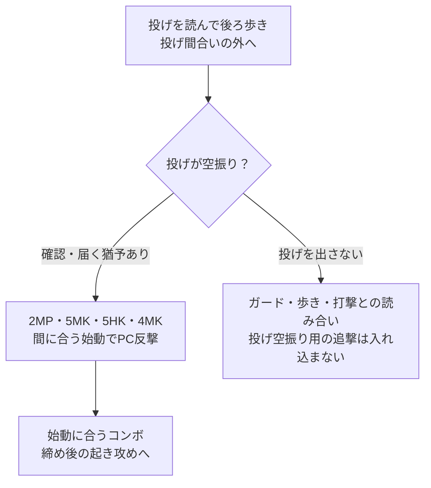
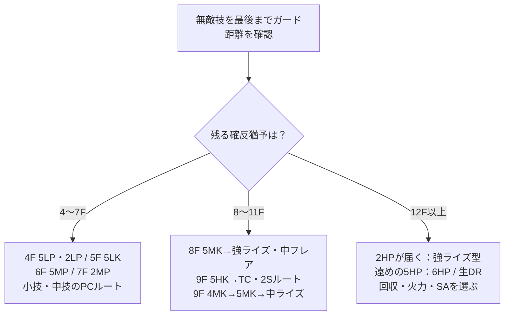

# イングリッド：確定反撃

[イングリッド](README.md) › [使い方](README.md#gameplay) › [守り・反撃](README.md#defense)

[ガード後の攻め](pressure.md) · [コンボ](combos.md) · [起き攻め](okizeme.md)

**まず猶予と距離で始動を決め、その始動からS回収・火力・リーサルを選ぶ。** 2HPの届かない場面には、4〜9Fの反撃と、リーチの長い5HPを用意する。完全入力・消費・参考ダメージはリンク先のコンボ表で比較する。

回収と火力のどちらを優先するかは、[採用する戦略と局面](strategy.md#comparison)も判断材料にする。

[猶予から選ぶ](#by-window) / [無敵技ガード後](#reversal) / [シミーの手順](#shimmy) / [練習する組](#practice)

## 反撃の猶予から始動を選ぶ

**ガード直後、その場で届く技を最速で出すことが基準。** 相手が-8Fなら、発生8Fの5MKは候補になるが、12Fの2HPは間に合わない。歩いてから押す場合は歩き・入力の遅れも猶予から引く。

| 必要な猶予 | 始動 | 対応するコンボ | 距離・用途 |
| --- | --- | --- | --- |
| 4F以上 | `5LP` / `2LP` | [5LPのPC→4MK~HP / 2LPを刻む型](combos.md#route-punish-4f) | 近距離。初段だけでなく2発目まで届くこと |
| 5F以上 | `5LK` | [中ライズ / ODフレア / DRC回収](combos.md#route-punish-5f) | 小技の間合いで反撃。S・Dの有無で締めを変える |
| 6F以上 | `5MP` | [TC→中ライズ / 中フレア / 2S火力型](combos.md#route-punish-6f) | 近距離。Dリバーサルへの反撃にも使う |
| 7F以上 | `2MP` | [PC→4MK~HP](combos.md#route-punish-7f) | しゃがみ姿勢から反撃。後続4MKの距離も確認 |
| 8F以上 | `5MK` | [強ライズ / 中フレア](combos.md#route-shimmy-5mk) | 2HPより早い。強ライズまでつながる距離が条件 |
| 9F以上 | `5HK` / `4MK` | [5HKのTC・2S・SA3](combos.md#route-shimmy-5hk) / [4MKのPC→5MK](combos.md#route-shimmy-4mk) | 後ろ入力から出せる候補。PC後の目押し先まで届くこと |
| 12F以上 | `2HP` | [強ライズ→回収 / 火力 / SA3](combos.md#route-punish) | 届けばノーDで回収・火力を選べる |
| 12F以上 | `5HP` | [6HP追撃 / 生DRで接近](combos.md#route-punish-5hp) | 2HPが届かない遠めの候補。通常必殺技キャンセル不可 |

各行は、始動が間に合う下限を示す。相手の-12Fを見たら必ず2HP、という意味ではない。5HP・5MK・5HKが届く場合はそれぞれのルートを選べる。全候補が届かない距離では、歩いて届かせる時間が残るかを確認し、残らなければ確反として技を振らない。

以下のPCルートは、初段が地上のパニッシュカウンターになる場面を想定する。
空中ヒット、通常ヒット、ガード後の有利Fは別条件。[技の発生](moves.md#normals) / [4MKの入力](moves.md#glow-touch)

## シミー：投げを空振らせてから反撃する

**投げ間合いから外れ、投げの空振りを確認して、届く打撃を硬直へ当てる。** シミーを選ぶ前の相性は[ガード後の攻め](pressure.md#dr5hk-guard)を参照。

### 後ろ歩きからの手順

1. [DR強Kガード後の+2F](pressure.md#dr5hk-guard)や、[強ライズ→弱空フレア後の前ステ](okizeme.md#after-ender)など、接近して択をかけられる場面を作る。
2. 相手の通常投げが空振る位置まで後ろ歩きする。下がりすぎて反撃技も届かない距離にはしない。
3. 投げが実際に空振りしたら、下表の技で反撃する。確認・前進に使った時間ぶんだけ反撃猶予が減るため、発生12Fの2HPを毎回の反応技にはしない。
4. PCが取れたルートを最後までつなぎ、[締め別の起き攻め](okizeme.md#after-ender)へ進む。

相手がガードしていれば直接のダメージはなく、後ろ歩きには下段・前進する打撃が当たり得る。通常投げの間合いや遅らせ幅でも必要な歩き量が変わる。

### 空振りを取る技と、その後

| 始動 | 発生 | 使い分け | PC後のルート |
| --- | ---: | --- | --- |
| `2MP` | 7F | しゃがんで反撃する候補。後続4MKも届く距離で使う | [4MK~HPへ](combos.md#route-punish-7f) |
| `5MK` | 8F | 5MKを使うときは後ろ入力を離して`5`へ戻す。`4`を入れたままMKを押すと4MKになる | [強ライズで回収・火力 / 中フレア](combos.md#route-shimmy-5mk) |
| `5HK` | 9F | 後ろ入力を保ったまま出せる。ヒット後の5MPか5MKが届く距離で使う | [TC / 2S火力 / SA3](combos.md#route-shimmy-5hk) |
| `4MK` | 9F | 後ろ歩きからそのまま出す別候補。PC後はHP派生と5MK目押しを区別する | [PC→5MK→中ライズ](combos.md#route-shimmy-4mk) |
| `2HP` | 12F | 投げ空振りを早く捉え、届いて間に合う場合。投げを読む先置き打撃とは分ける | [強ライズ→回収・火力](combos.md#route-punish) |

**5MKの初段が届いても、強ライズまで届くとは限らない。** [調整後の公開記述](https://note.com/nishiuri9235/n/n0efb730fe4eb)にも当たり方による不成立例がある。同じシミー距離で強ライズがつながるかを確かめ、つながらない位置では[中フレア締め](combos.md#route-shimmy-5mk)や別の始動を選ぶ。

投げ空振りが起きなかった場合や、反応が遅れて間に合わない場合は、投げ空振りへの確反として打撃を入れ込まず[地上戦](neutral.md)・[攻めの読み合い](pressure.md#dr5hk-guard)へ。

## 無敵技をガードした

**最終段までガードし、相手の着地位置と残る隙を見る。** 2HPが届いて12F以上あれば、まずノーDの強ライズ型を比べる。遠ければ5HP、短い隙には4〜9Fの始動から取る。

図は猶予ごとに追加できる始動の候補。12F以上あっても、届く5MKや5HKなどの速い始動を選べる。まず初段と追撃が届く型を選ぶ。

4〜7F側の完全入力は[小技・中技のPC反撃](combos.md#route-punish-fast)、8〜9F側は[5MK・5HK](combos.md#route-shimmy)、遠めの12Fは[5HP始動](combos.md#route-punish-5hp)。小技も届かない場合は、[猶予と距離の表](#by-window)で歩く時間を含めて再判定する。

### 2HPが成立したら、何を取るか

| 欲しい結果 | コンボ表のルート | 収支 | 締め後 |
| --- | --- | --- | --- |
| Dを使わずSを増やす | [2HP[PC]→弱空フレア](combos.md#route-punish) | D0、S+1 | 前ステ後約+5F |
| Dを使わず火力を取る | [2HP[PC]→中空フレア](combos.md#route-punish) | D0、S増減0 | 2前ステ後約+9〜10F |
| D・Sを使って火力を伸ばす | [OD空フレア→中ライズ](combos.md#route-punish) | D2、開始1S / 2S以上で型を分ける | 中ライズ締め後へ |
| リーサル | [2HP[PC]→低めj.MP→236236P](combos.md#route-punish) | SA3消費、D0・S0 | 強度は未特定 |

- 弱空フレアと中空フレアの参考ダメージ差は630。S回収か、火力と長いダウン時間かを選ぶ。
- 中空フレア後は2前ステの代わりに地上214LPでS回収もできる。回収後約+1〜2Fだが、距離は離れる。
- 2HPが届く確反で5HP→生DRを使う場合は、1D追加するリターンも比べる。5HPには[D0の6HP追撃](combos.md#route-punish-5hp)もある。
- OD型は調整前からの公開ダメージを含む。条件と参考値は[コンボ表](combos.md#route-punish)を参照。

ダウン後の入力・密着条件は[締め別起き攻め](okizeme.md#after-ender)で確認する。

SAゲージ2本を使う別候補として、[214214HP[消費2S]生発動からの反撃](combos/sa2.md#raw-punish)も収録。
発動後のODライズが反撃猶予内に届く条件を個別に確認する。

## トレモで始動と距離を固定する

- **無敵技ガード**：相手の技→ガードを録画し、密着と先端で反撃する。最速入力時の硬直差、初段PC、最後までの連続ヒットを確認する。初段だけ届くケースも切り分ける。
- **小さい隙**：まずDリバーサルガード→5MPのTCを練習する。そのあと、実際に対戦で困る-4F / -5F等の技ごとに小技の届く位置を固定する。
- **シミー**：同じ接触距離から、即投げ・遅らせ投げ・ガード・下段を別々に録画する。投げだけを空振らせられる歩き量と、5MK / 5HK / 4MKの入力を確かめる。
- **5MKの距離**：同じPC始動で強ライズ型と中フレア型を試す。強ライズが空振る位置を、S回収ルートの成功として記録しない。

## 参照

追加調査：2026-11-04。以下は公開レシピと筆者の調査を参照した整理で、このノートでのゲーム内再実測とは区別する。各ダメージの対象時期は[コンボ側](combos.md#route-punish-fast)に記す。

- [ドス：コンボ・起き攻めまとめ](https://note.com/dos236236/n/nd3f3300416b7) — 5F確反、5HK[PC]、2HP[PC]、締め後の例。本文の最終更新記載は2026-06-08。
- [めい：週末までに調べたイングリッド](https://note.com/maytan0412/n/ne756d622e2f0) — 2026-06-01。4FのPC追撃、2MP・5HK・2HPのシミー使い分け。
- [かくぶろ：コンボまとめ](https://takukakugamer.com/sf6-ingrid-combo/) — 2026-09-16更新。Dリバーサル反撃、4MK[PC]、5HP[PC]、5LKのDRC型。
- [西瓜Chang：地上戦の技の振り方](https://note.com/nishiuri9235/n/n0efb730fe4eb) — 2026-08-04・08-12追記。5MK[PC]→強ライズの変更と距離条件、4MKの性質。
- [通常技の発生](moves.md#normals)
- [CAPCOM：2026-08-03調整](https://www.streetfighter.com/6/buckler/en/battle_change/20260803/ingrid)
