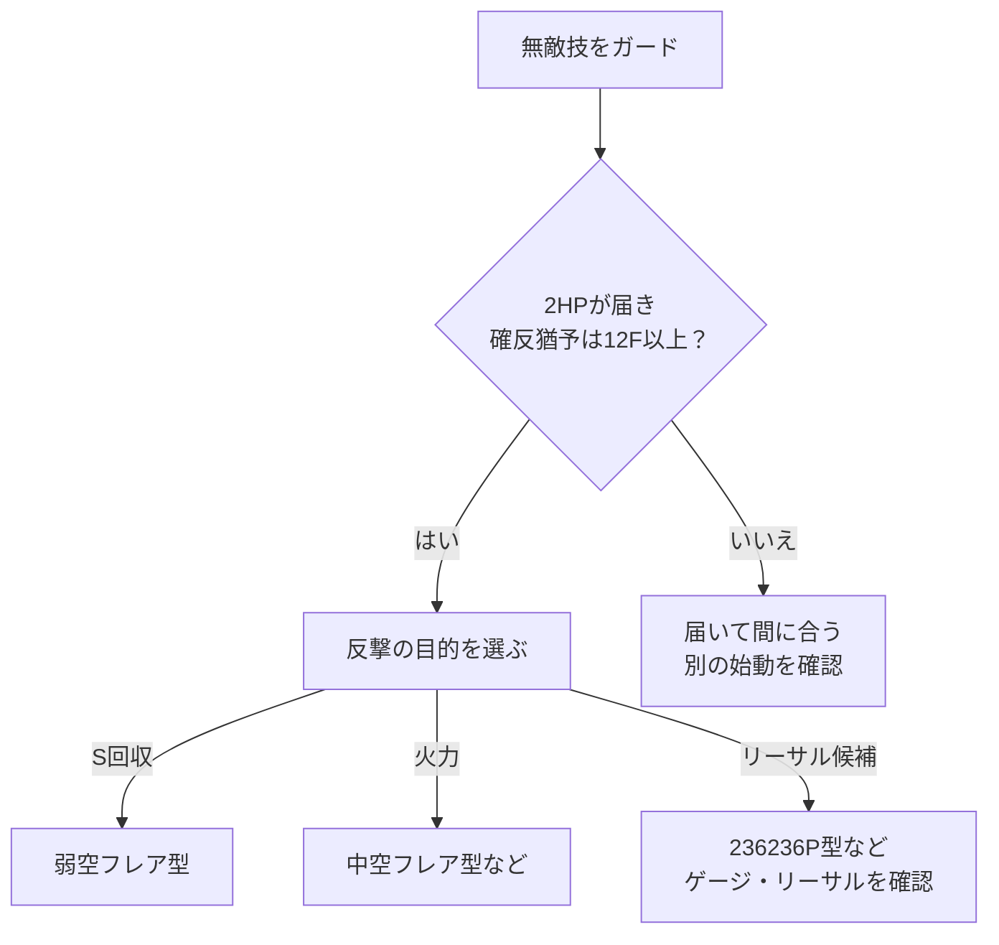

# イングリッド：確定反撃

[イングリッド](README.md) › [使い方](README.md#gameplay) › [守り・反撃](README.md#defense)

[ガード後の攻め](pressure.md) · [コンボ](combos.md) · [起き攻め](okizeme.md)

**反撃できる隙と距離を確認し、S回収・火力・リーサルから選ぶ。** 完全入力とダメージはリンク先のコンボ表で比較する。

回収と火力のどちらを優先するかは、[採用する戦略と局面](strategy.md#comparison)も判断材料にする。

## シミー成功：投げ空振りを取った

**5MKと5HKを、距離と確反猶予で使い分ける。** 相手が投げ抜けを選んで実際に空振りした後の話。シミーを選ぶ前の相性は[ガード後の攻め](pressure.md#dr5hk-guard)を参照。

| 始動 | 発生 | 選ぶルート | 条件・狙い |
| --- | ---: | --- | --- |
| `5MK[PC]` | 8F | [強ライズ→弱空フレア](combos.md#route-shimmy) | S回収型。先端接続・総ダメージは未実測 |
| `5MK[PC]` | 8F | [強ライズ→中空フレア](combos.md#route-shimmy) | 火力型。接続距離と高度を確認 |
| `5MK[PC]` | 8F | [中フレア締め](combos.md#route-shimmy) | 強ライズが届かない場合の候補 |
| `5HK[PC]` | 9F | [TC→中ライズ](combos.md#route-shimmy) | リーチ・継続を比較。後続5MPの距離が必要 |
| `2HP[PC]` | 12F | [強ライズ→空フレア等](combos.md#route-punish) | 残硬直が長い場合。短い投げ抜けへの反応の主軸にはしない |

5MK[PC]→強ライズは2026-08-03調整後の情報。そこから先の空中締めが全距離で成立するという意味ではない。成立後は[弱・中空フレア / 中ライズ後](okizeme.md#after-ender)へ。

投げ空振りが起きなかった、届かない、間に合わない場合は、反撃確定とみなさず[地上戦](neutral.md)か[攻めの読み合い](pressure.md#dr5hk-guard)へ戻る。

## 無敵技をガードした

**2HPが届き、12F以上の確反猶予があれば、ノーDの反撃を軸に比較する。** 技・距離によっては、より速い別の始動が必要。

目的を選んだ後、下表と[完全コンボ](combos.md#route-punish)でコスト・ダメージ・接続条件を比べる。

| 欲しい結果 | コンボ表のルート | 収支 | 締め後 |
| --- | --- | --- | --- |
| Dを使わずSを増やす | [2HP[PC]→弱空フレア](combos.md#route-punish) | D0、S+1 | 前ステ後約+5F |
| Dを使わず火力を取る | [2HP[PC]→中空フレア](combos.md#route-punish) | D0、S増減0 | 2前ステ後約+9〜10F |
| 5HPからつなぐ | [5HP[PC]→DR→空フレア](combos.md#route-punish) | D1、弱締めならS+1 | 空フレアの種類で選ぶ |
| D・Sを使って火力を伸ばす | [2HP[PC]→OD空フレア](combos.md#route-punish) | D2、S1 / 2消費 | 中ライズ型 |
| リーサル | [2HP[PC]→低めj.MP→236236P](combos.md#route-punish) | SA3消費、D0・S0 | 強度は未特定 |

- 弱空フレアと中空フレアの参考ダメージ差は630。S回収か、火力と長いダウン時間かを選ぶ。
- 中空フレア後は2前ステの代わりに地上214LPでS回収もできる。回収後約+1〜2Fだが、距離は離れる。
- 5HP始動はシミー後の標準反応に固定しない。2HPが届く確反では、1D追加するリターンも比べる。
- OD型は調整前からの公開ダメージを含む。条件と参考値は[コンボ表](combos.md#route-punish)を参照。

ダウン後の入力・密着条件は[締め別起き攻め](okizeme.md#after-ender)で確認する。

SAゲージ2本を使う別候補として、[214214HP[消費2S]生発動からの反撃](combos/sa2.md#raw-punish)も収録。
発動後のODライズが反撃猶予内に届く条件を個別に確認する。

## 参照

- [通常技の発生](moves.md#normals)
- [CAPCOM：2026-08-03調整](https://www.streetfighter.com/6/buckler/en/battle_change/20260803/ingrid)
