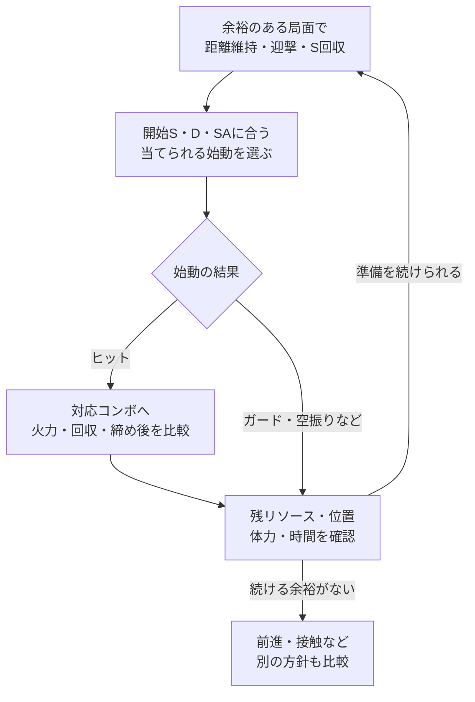

# 戦略仮説：S蓄積・大火力

[イングリッド](../README.md) › [戦略の比較](../strategy.md) › S蓄積・大火力

**自分からの接触を抑えてサンシンボルを蓄え、一度の始動から高火力コンボで大きく体力を奪う案。** 今回ユーザーが挙げた方向性を、戦略仮説として整理する。

## 狙う勝ち筋

距離維持・弾・迎撃で準備の時間を作り、Sと必要なD・SAを持ってヒット機会を迎える。
ガード接触によるD削りや端への前進より、**準備中の損失を抑え、当たったときのリターンを大きくすること**を主に評価する。

何Sまで蓄えるか、何を始動にするか、どの消費で十分な火力を得られるかは検討する。
「一度当てれば必ず倒せる」というダメージやレシピは、現時点では固定しない。

## 準備中の立ち回り

**初回のダウンを取る前から、距離と相手の行動によって回収機会を探す。** 接触→ダウン→回収という経路に加え、接触を抑えたまま準備する経路を検討する。

| 局面 | 試したい方針 | 確認すること |
| --- | --- | --- |
| 相手がすぐ届かない距離 | 弾や距離維持を使い、地上`214LP`の機会を作る | 相手のDR・ジャンプ・弾抜けが回収を咎めるか |
| 相手が近づいてくる | 迎撃やガードを選び、ヒット時の変換を狙う | 迎撃の成功とCH成立を混同しない |
| 相手が待っている | 回収の利益と、失う時間・位置を比べる | 体力差と残り時間が準備を許すか |
| ダウンを取った | 回収・弾再設置・距離の作り直しを候補にする | 回収後の残りFと、次の相手の接近 |

回収自体の性能は[フレア・S回収](../moves.md#sunflare)、弾と迎撃の技術は[地上戦](../neutral.md)を参照。

## 蓄積後：何を当て、どう火力に変えるか

**Sを持った状態で、実際に当てられる始動と対応ルートを組み合わせる。** 以下は既存ノートから検討できる入口で、採用する主軸はまだ決めない。

| 入口の候補 | 既存の資料 | 詰めたい条件 |
| --- | --- | --- |
| 通常技のヒット | [5MK・2HP](../combos.md#route-mid) | 接触リスクに対するリターン、開始Sと追撃 |
| DR止めのCH | [2MPカウンター](../combos.md#anti-dr-combo) | CH・距離・最速の条件、その後のS消費 |
| 投げ空振り・無敵技への反撃 | [PC反撃](../punish.md) | 反撃猶予・距離、回収型と火力型の比較 |
| 強化フレアのヒット | [S使用ルート](../combos.md#route-enhanced) | S別・位置別の追撃、ガード時の消費 |
| SAゲージ2本を使えるヒット | [SA2の回収・火力・運び](../combos/sa2.md) | SA2でSを回収する型と、その場で火力を取る型の比較 |

現在のコンボ一覧は、この戦略用の高火力ルートを網羅していない。
採用候補は**完全入力・必要S・D/SA消費・ダメージ・締め後**をセットで追加する。
SAはコマンド・ボタン強度・ホールド段階を[記法](../../notation.md#move-variants)に従って区別する。

具体的な比較の入口として、[6HP→OD空フレアとTCの2S火力型](../combos/finishers.md#stock-two)を収録。
前者はSAを使わない追撃、後者はSA3まで使う型として分ける。
SAを温存したい場合は[SA1の消費S別](../combos/finishers.md#normal-sa)や、
[SA2の火力・回収・運び](../combos/sa2.md#sa2-hk-carry)も比較する。
始動や位置の違う掲載値を単純に並べて、最適な1本を決めない。

## リソースとダウン後

| 見るもの | この案で比べたいこと |
| --- | --- |
| S | 次のルートに必要な量と、さらに貯める利益。最大まで貯める必要があるか |
| D・SA | 高火力ルートに必要な量と、準備・防御で使う量 |
| ヒット後 | 体力を奪い切る締めか、次のSを回収できる締めか |
| ガード後 | SやDを使った後、次のヒット機会へ戻れるか |
| 自分の位置・体力・時間 | 後退や待ちにどれだけ余裕があるか |

ダウン後の入力・有利Fは[締め別の行動](../okizeme.md#after-ender)を参照する。
既存の「S回収型」が、そのままこの案での最適な締めになるとは決めない。

### 準備と投入の循環

**ヒットしなかったときも、残ったS・Dと失った位置を見て準備を続けるか決める。** この図も戦略仮説で、蓄積目標のS数や投入ルートを固定するものではない。

## 他の方針と比較したい状況

- 相手のDが少ないとき、準備を続ける利益と[D削り・端攻め](pressure-and-corner.md)の利益はどちらが大きいか。
- 自分が端に近づいたとき、どこまで距離維持と回収を続けられるか。
- Sを十分持った後も相手が待つ場合、何を当てる入口にするか。
- 準備や最初の始動が失敗した後、どの位置・リソースから立て直せるか。

比較の際は、回収中の被弾・失う位置・始動の当てやすさ・一度のヒットのリターンを一緒に見る。
固定の型として続けるか、試合中に別の方針へ切り替えるかも検討対象にする。

## この案の根拠と未整理の部分

出発点はユーザーが挙げた戦略仮説。技術上の候補は既存の技データ・コンボ・立ち回りから参照している。
特定プレイヤーの実践や、この案の優位性を確認した記録ではない。

まず詰めたいのは、接触前の回収機会、主軸にできる始動、S別の火力ルート、待てなくなる状況。
[戦略の比較](../strategy.md)で、D削り・端攻め案と同じ状況を見比べる。
