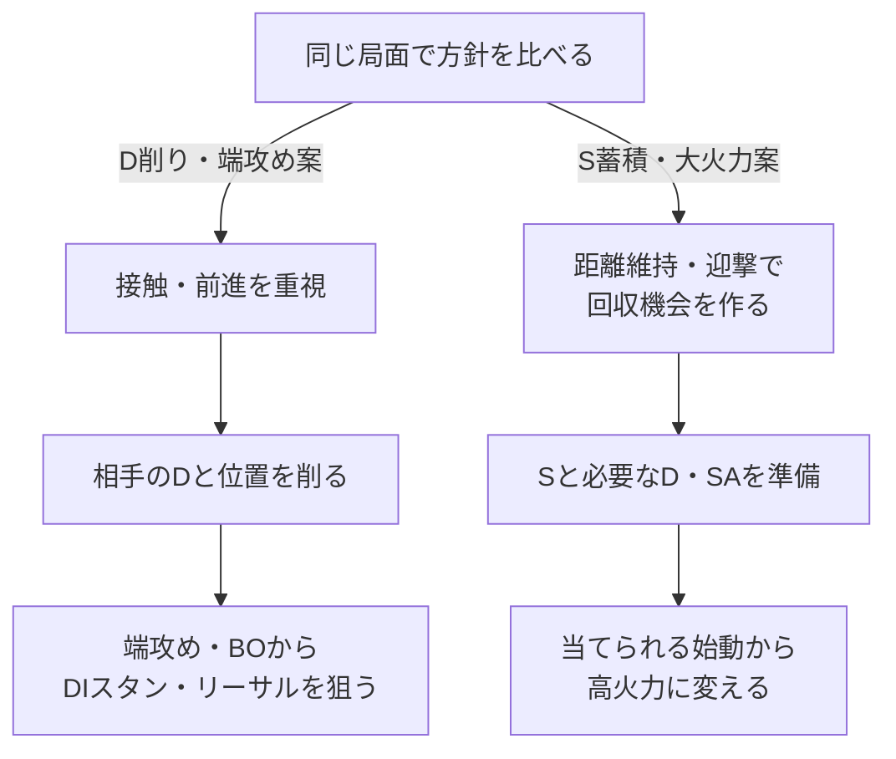

# イングリッド：戦略の比較

[イングリッド](README.md) › 戦略

[地上戦](neutral.md) · [攻め](pressure.md) · [起き攻め](okizeme.md) · [コンボ](combos.md)

**何を勝ち筋にし、準備・接触・リソースをどう配分するかを、複数の仮説で比較する。**
共通の技データや場面別の技術を使いながら、優先する利益と行動頻度を変えて考える。

## 2案で狙う流れ

**下の分岐は、先に選ぶ方針の比較。** 相手・位置・体力・時間・リソースに応じて試合中の切り替えも考える。各案の優位性を確定した図ではない。

端BOでもDIは確定ではなく、S蓄積案でも必要Sや高火力ルートは検討中。詳細は各案で確認する。

## 検討する戦略仮説

### D削り・端攻め案

**接触から相手のDと位置を削り、端攻め・BO・DIスタンを勝ち筋にする。**
これまでの基本戦略の内容は、[D削り・端攻めの詳細](strategies/pressure-and-corner.md)にまとめる。

### S蓄積・大火力案

**自分からの接触を抑えてSを蓄え、一度の始動を高火力に変える。**
回収機会・当てる入口・リソース投入を、[S蓄積・大火力の詳細](strategies/stock-and-burst.md)で検討する。

## 同じ局面をどう読むか

以下は各仮説の狙いを比べる表。どちらが有利か、どの相手に適するかはまだ決めない。

| 局面 | D削り・端攻め案 | S蓄積・大火力案 |
| --- | --- | --- |
| 初回の接触前 | 通常技や弾から接触し、ダウン・前進につなげる | 距離維持・迎撃で接触リスクを抑え、回収機会を作る |
| Sを確保した | 強化フレアのガード圧力や攻め継続に使う | 高火力に変えられる始動と、投入するS・D・SAを選ぶ |
| ダウンを取った | 接近・弾・S回収から端圧力につながるものを選ぶ | 回収・再準備と、そのまま火力や攻めを取る利益を比べる |
| 相手が端・D少 | 位置を保ち、削りや脱出阻止を優先する | 回収の利益と、端・D削りの機会を手放す損失を比べる |
| 準備・攻めが失敗した | 自分のD残量、相手のBO回復、逃げられた位置を見る | 回収中の被弾、失った位置、消費後のS・Dを見る |

## 戦略を選ぶ材料

- **相手**：回収を咎める手段、接触を拒否する手段、狙える反撃。
- **局面**：自分と相手の位置、体力差、残り時間。
- **リソース**：自分のS・D・SA、相手のD・SA。
- **実行できるルート**：当てられる始動と、そこから得られる火力・位置・次の準備。

同じ試合中の切り替えも検討する。どちらかをキャラ全体の唯一の正解には固定しない。

## 場面別の技術・対策との関係

| 調べたいこと | 置き場所 |
| --- | --- |
| なぜその行動を優先するか | 各戦略仮説のページ |
| その距離で使える技・迎撃 | [地上戦](neutral.md) |
| ガードさせた後の択 | [攻め](pressure.md) |
| ダウン後に何が間に合うか | [起き攻め](okizeme.md) |
| 始動後の完全入力・コスト・結果 | [コンボ](combos.md) |
| 相手の行動への回答、戦略の制約 | [使用側からの対策](matchups/README.md) |

新しい仮説は戦略フォルダに追加し、同じ局面・判断材料で比較する。[ノートのまとめ方](../guide.md#strategy-template)
